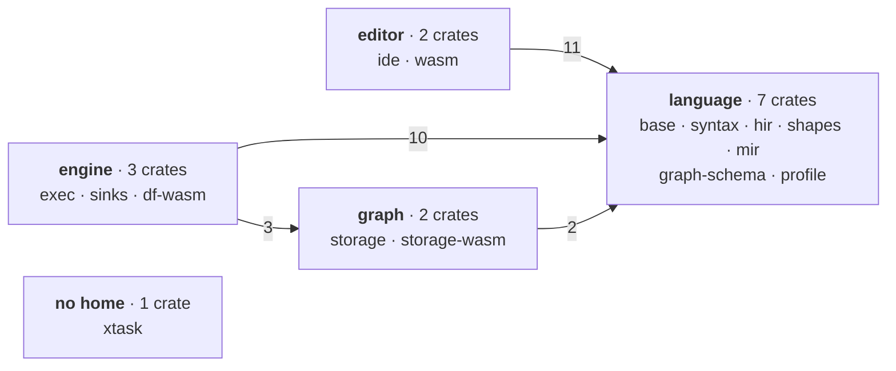

fossil has **three boundaries — program, plan, artefact** — and the first two are each specified by a
data file that generates code rather than by prose that describes it. `grammar.bnf` is the shape of a
program and `catalogue.bnf` is the names a program may write. The artefact is not fossil's to specify:
it is an Apache GraphAr graph and an RML-Core mapping, and [the format](/docs/format) says which
conventions fossil adds to them. Everything below hangs off one of the three.

**This page states the shape and links to the page that argues each part.** Where a section would
restate an argument, it is a sentence and a route instead. That is the discipline, and it is the one
this repository has paid for twice.

## What a graph is

**A GraphAr graph and its mapping.** A vertex type is `<Type>.vertex.yml` and a property group of
Parquet chunks, a relation is `<Src>_<label>_<Dst>.edge.yml` with an adjacency list ordered by source,
`fossil.graph.yml` names them all, and `mapping.ttl` says what the tables mean as RDF
([the graph](/docs/design/graph), [the format](/docs/format)). The index is per type, and the global
id is the reader's arithmetic over the types. Every reader names the ROLE it means rather than a
column name: the identity is the property with `is_primary`, an address is GraphAr's index. The graph
carries the data and not a picture of it:
[where a vertex is drawn](/docs/design/position) is the view's choice. There is no directory listing
over HTTP and the format asks for none.

**The graph has no coarse face.** A reader draws every vertex; the tiles, the cell pyramid and the
quotient edges that let a reader draw less were [deferred](/docs/design/later/cells) with their
measurements and the condition that brings them back.

## What the writer is

One call, `fossil_sinks::graphar::write`, and one host that makes it: the wasm build, in a browser tab or in
Node, under a 2 GiB budget it refuses past by name
([three hosts](/docs/design/three-hosts#what-the-wasm-writer-holds-and-how-it-says-no)). There is no
native write host, and [what was discarded](/docs/design/discarded#the-tooling) says what would bring
one back.

| the step | where | what it produces |
| --- | --- | --- |
| every vertex, then every edge, with a hard barrier between them | `crates/fossil-exec/src/lib.rs, execute_graph` | the payload columns and the edges, as Arrow in memory; `dense_id` numbered globally as each type lands (`crates/fossil-exec/src/lib.rs, prepend_dense_id`) |
| the layout: every table as GraphAr's, held to admissibility | `crates/fossil-sinks/src/graphar/layout.rs, layout` | the information files and the batches, per-type indices, `write/*` refusals before a byte is written |
| the mapping | `crates/fossil-mir/src/describe.rs, describe` | the RML-Core document of the tables, A2 held, from the types alone |
| one chunk per table, row groups of 122,880, every page ZSTD, footers carrying the counts | `crates/fossil-sinks/src/graphar/write.rs, write` | the chunks, the counts, `mapping.ttl`, the information files, and `fossil.graph.yml` last |

Nothing is staged and read back: the writer encodes the batches the executor already held.

**A run can write the triples instead.** `fossil_sinks::ntriples::write` writes the same graph as one
N-Triples document, `graph.nt`, when the host chooses `Sink::NTriples` (`crates/fossil-sinks/src/lib.rs, Sink`);
it is a cargo feature, and a host that writes only GraphAr links none of it. It is not a second copy
beside the tables: a run writes one or the other. What a program means as RDF is defined there, in
`crates/fossil-sinks/src/ntriples.rs, triples`, and `crates/fossil-exec/tests/ntriples.rs` holds every
conformance program to it: the mapping, read over the tables the same program writes, gives the same
set.

**The graph document is written last, and that is not tidiness.** `fossil.graph.yml` is the commit: a
reader opens nothing it does not name, so a run that fails halfway leaves chunks no reader will find.
And a document written before the bytes can only *promise* them, while a count file is measured.

## What the reader is

**One door, and it is not fossil's** — `attachGraph` in `@kanzo-tech/graphar-duckdb`, TypeScript with
no crate behind it, always handed an engine, a catalog name and a `resolve`:

```ts
await using graph = await graphar.attachGraph(engine, 'job', (paths) => paths.map((p) => `${prefix}${p}`), {
  entry: 'fossil.graph.yml',
});
```

It attaches the graph to the host's `Engine` as the catalog it is given: a view per type, and the
information files as five relations. Every read after that is the host's SQL. Pruning is the
engine's: every table is written in the order of its key, and DuckDB skips the row groups whose footer
statistics exclude a predicate. [One door](/docs/design/one-door) argues the surface; the credential
is `@fossil-lang/storage`'s `mount`, called by the host.

The reader's **policy** over that contract is deliberately not on the door, and not in this
repository: what a graph is drawn WITH and what is already LOADED belong to the viewer,
`@kanzo-tech/graph`. An encoding is a reader's ranking of what to do with a column, and a residency
budget is a number measured against one renderer on one graph. Neither is a property of the
artefact.

## What is declared and what is derived

One rule: **a document carries a fact exactly when a reader cannot recover it from the bytes, or
must have it before it reads them.** The information files carry the types, their properties and
their GraphAr types because `attachGraph` makes views out of them; and the count files because a
viewer sizes its buffers before the first byte. What they do not carry — an extent, a column's domain,
statistics — is in the Parquet footers or one query away, and what a class or a predicate is, is in
the mapping. [Position](/docs/design/position) argues the field it no longer carries.

## The graph today

The same three boundaries seen from the tree: `language` and `editor` serve the program, `engine`
runs the plan, `graph` is the artefact's storage. Grouped by what each crate is about, because fifteen nodes
drawn flat show nothing. The ugliness is the finding, not a failure of the drawing.

The three `-wasm` crates live under `bindings/` and not `crates/`: they are the workspace's
`cdylib`s, the `wasm-bindgen` entry points, one per npm package, which is how swc (`bindings/`) and
oxc (`napi/`) lay a Rust workspace with JavaScript bindings out. Each keeps its crate name, because
the name is the stem of the artefact its package loads. A library that only offers a `js` feature,
as `fossil-storage` and `fossil-graph-schema` do, stays under `crates/`.



**26 cross-group edges**, and no pair runs both ways. Every number above
is derived from `crates/*/Cargo.toml` and `bindings/*/Cargo.toml`, `[dependencies]` only: a test may depend on whatever it
likes, so dev edges are out of scope here for the same reason they are in `content.test.ts`, which
reads the manifests and fails the build on any figure in this diagram that stops holding.

No edge runs from the editor to the engine, and the editor links no database: the browser runs
`fossil-profile`'s plan on DuckDB-WASM, because without the columns a `DESCRIBE` finds the editor is
silent on every diagnostic whose evidence is a source's schema. The plan itself is a language crate
that links no engine ([Profile](/docs/design/profile)) — and one of the engine's edges into the
language, `fossil-sinks → fossil-profile`, is that same plan: the GraphAr writer counts what it
wrote with it, rendered on DataFusion ([the graph's own facts](/docs/design/facts)).

The arrow between engine and graph runs one way:

| direction | edge | why it is there |
| --- | --- | --- |
| engine → graph | `fossil-exec → fossil-storage`, `fossil-sinks → fossil-storage`, `fossil-df-wasm → fossil-storage` | a run reads its sources and writes the graph through the job's store |

`fossil-storage` is filed by subject and not by history. The graph format is not on that side at
all: the layout is `fossil_sinks::graphar::layout`, because the format is the writer's and nothing else lays out a
graph, and the mapping is `fossil_mir::describe`, a pure function of the types that a host asks before a
run
([the crates, as the references cut them](/docs/design/incremental#the-crates-as-the-references-cut-them)).
The graph side reaches into the language at one crate only — `graph → language` is `fossil-storage` and
`fossil-storage-wasm` taking `fossil-graph-schema` for the error catalogue, the leaf where shared
vocabulary goes ([one error](/docs/design/errors)) — and at nothing that parses or resolves. [One engine](/docs/design/one-engine) is where the rest
of the filing gets settled.

One thing has left `fossil-base`, and it does not show on this diagram. The `tracked` query that
decodes a shape document is `fossil_hir::shape_documents`, and it cost **no** edge: its only production caller was `fossil-hir` already, and `fossil-hir` already
depended on `fossil-base`. A module crossing a boundary that was already crossed is the cheapest
kind of move there is.

The only write host is `fossil-df-wasm`; nothing native writes a graph.

## What is left of the rings

The attractive cut is three numbered rings by where the code runs. It is not the cut, and
[three hosts](/docs/design/three-hosts) is where the three reference compilers say why. Nothing survives
of it: no crate carries a `wasm32` tripwire any more. The last two to refuse were the language server, a stdio transport over crossbeam, which
was [deleted](/docs/design/discarded#the-tooling), and `fossil-resolver`, refusing wasm32 to keep
credentials out of the browser; a vended credential is short-lived and prefix-scoped, and reaching
the browser is what it is for, so the crate became `fossil-storage` and compiles there.

## A list is not a check

> `duckdb` and `datafusion` are each reachable only from crates that declare themselves native.

`deny.toml` names six wrappers for `duckdb` and five for `datafusion` (measured 2026-08-25), but
`cargo deny check bans` matches `wrappers` against the **direct** parents of a banned crate, so a
crate one hop further away is invisible to it — measured with the since-deleted language server linking a bundled database
while `cargo deny` printed `bans ok`. `crates/xtask/tests/engine_reach.rs` closes it, deriving the
policy from `deny.toml` and the truth from `cargo metadata`.

## `base` means two opposite things

The two references that have a crate called `base` give it contrary contents:

| | `gluon_base` — 11,970 lines | rust-analyzer's `base-db` — 1,866 |
| --- | --- | --- |
| contents | AST, types, kinds, symbols, positions | salsa plumbing, the input queries, `CrateGraph` |
| language vocabulary | **is** the vocabulary | **none** |
| describes itself as | "modular" | *"Basic database traits. The concrete DB is defined by `ide`"* |

`base-db` states two invariants — *"knows nothing about cargo"*, *"doesn't know about file system
and file paths"* — and its VFS is another crate, the operating-system implementation a third. ty
cuts the other way: `ruff_db` holds the Salsa inputs *and* the file abstraction beside them.

> **A crate called `base` holds the substrate and the file abstraction, and nothing that decides
> something about a program.**

fossil takes ty's cut ([the crates, as the references cut them](/docs/design/incremental#the-crates-as-the-references-cut-them)).
Where a written path points is the file abstraction, and it is `fossil_base::location`, beside the
connections it expands through. The shape-document decode is not, and it is
`fossil_hir::shape_documents`: both references hold *input queries* in their `base`, and a query
that runs a decoder over a document to produce a type is not an input, it is the compiler asking a
question.
What stayed in `providers` is the ROW a decoder fills, because a table entry is not a decision about
a program.

**What stayed, and why it is not the same case.** `test_support` is also not compiler logic — its
own header says so — and lifting it out looks like the identical move. It is not: a helper that
implements `System` must depend on `fossil-base`, `fossil-base`'s unit tests must depend on the
helper, and `#[cfg(test)]` makes the crate under test a second copy of `fossil-base` whose types do
not unify with the one the helper linked. It does not compile, and the rest of the bill is in
[what was discarded](/docs/design/discarded). The distinction the rule actually draws is *decides
something about a program*: the shape-document decode did, and a decoder for a format no program is
written in does not.

## The verdict is not the crate count

**Fifteen crates**, against Gluon's ~11 crates for 90k lines, Gleam's 15 (six real) for 228k
and rust-analyzer's 36 for 571k. The line count that used to sit beside this number is deliberately
not restated: it was measured on 2026-08-25 and the tree has changed since, so the only honest
options were to re-measure or to drop it.
**At this size the honest target is five to eight.**

Most of the movement was moves, not new code: `fossil-location` arrived by moving a module down out
of `fossil-base` and went back into it, with `fossil-lineage` into `fossil-hir` and `fossil-sinks`
into `fossil-df`, `fossil-shex` and `fossil-descriptors-output` went into `fossil-hir` when a shape
document became a type, `fossil-descriptors-input` into `fossil-base` when a source's columns became
the value of an input, `fossil-engine` left by moving three into the crate that already used them, two
arrived carrying a write-time bound and left when it was [removed](/docs/design/discarded#privacy),
`fossil-tile-writer` arrived by moving a struct out of a crate that never called it and left with the
tiles, `fossil-cli` left with the native host, and `fossil-graph` and `fossil-graph-wasm` left when
the reader became TypeScript, and `fossil-layout` left when the graph stopped carrying a picture. `fossil-df` was split in two, the
engine `fossil-exec` and the output formats `fossil-sinks`, when a second format was designed: a
format is a cargo feature, which is a `cfg`, and a host that writes only GraphAr links no other. The
shape-document decoders left `fossil-hir` for `fossil-shapes`, so that the compiler names no schema
language and a document is one more decoder of the vocabulary a declared type lowers to.
Which is the point of the heading — the count went 25 → 26 → 25 → 27 → 28 → 26 → 24 → 22 → 21 → 16 → 14 → 13 → 14 → 15 and none of those numbers is the verdict.

What makes a crate list feel like a maze is not the count. One of them lies about what it is, and a
false name costs more than a surplus crate because you cannot skip it while reading. There were
three: `fossil-engine` was not an engine, it was the native host, and `fossil-sinks` wrote nothing,
it was the old manifest model; each became a module of the one crate that used it. The name
`fossil-sinks` is back, and now it is what it says: the formats a graph is written in.

| the name | what it actually is |
| --- | --- |
| `fossil-ide` | not an IDE: the set of editor functions `fossil-wasm` calls, and it outlived the native language server it was split out for. It also returns `lsp_types` structs directly (`crates/fossil-ide/src/completion.rs, completions`), which is the invariant rust-analyzer defends hardest and the one Gleam broke |

<Callout title="Deliberately absent">
**No numbered layers.** A rule that needs a number to explain itself is a taxonomy, not a rule.

**No crate named after its deployment target.** The one crate rust-analyzer names after a process
boundary is `proc-macro-srv-cli`, and procedural macros segfault — fault isolation, not a ring.

**No crate that exists by imitation.** A crate earns its boundary from a cycle, a `cfg`, an orphan
rule or a publishing frontier. A crate that has none of the four is a module of the crate whose
subject it is.
</Callout>

## The reader has no crate

A graph is YAML and Parquet, so a reader is a YAML parse and `read_parquet`, and
`@kanzo-tech/graphar-duckdb` is exactly that — TypeScript over the host's engine. Nothing on the read
side links a fossil crate or loads a fossil wasm build.

The seam between the two halves is the graph on disk, and it was never an API: `kanzo-ui` reads
graphs written by fossil through that package, and
[reading one without fossil](/docs/format/reading/without-fossil) is the whole recipe for a reader
that does not.

## What is on this page and what is not

The page is the shape; [three hosts](/docs/design/three-hosts) is the argument. The measurement that
reordered the whole priority — a compiler that reports success and writes a graph with a property
missing — is [the expression cliff](/docs/design/expressions); the scope of the incremental system is
[tooling for humans](/docs/design/tooling-for-humans); and whether the specification belongs in its
own repository was settled against five projects in [prior art](/docs/design/prior-art).
