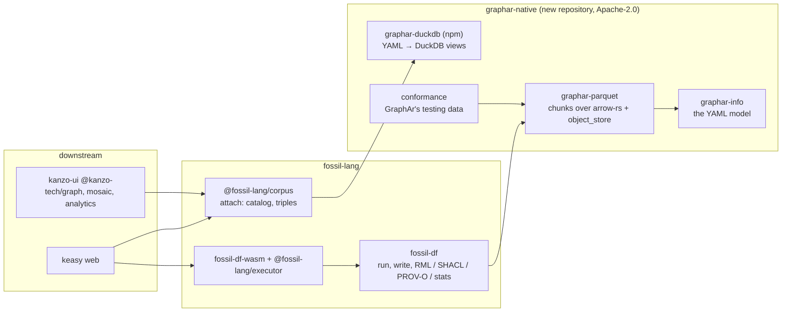

`fossil/1` is fossil's own format. It is one Parquet file per table under a `fossil.json` that carries
the tables and also everything a reader needs to make RDF of them, to count them and to trace them
([the corpus](/docs/design/corpus), [the corpus's own facts](/docs/design/facts)). **This page
reverses that in two moves, and it is a direction, not yet a fact.**

1. **The tables become Apache GraphAr.** They are written and read by a native Rust implementation of
   GraphAr in a repository of its own: arrow-rs and parquet, compiling to `wasm32`, Apache-2.0,
   written so that it can be offered to Apache GraphAr, and tested against GraphAr's own test data.
   fossil depends on it and nothing in it depends on fossil.
2. **What GraphAr cannot hold goes to the standard that owns it.** That is never to a sidecar of
   fossil's own:
   - the RDF reading of the tables goes to an **RML-Core** mapping;
   - the annotations go to a **SHACL** shapes graph;
   - the lineage goes to **PROV-O**;
   - the counts go to **Parquet's footers**.

`fossil.json`, `corpus.bnf`, `cargo xtask corpus` and the manifest's JSON Schema go, and nothing
replaces them.

[Discarded](/docs/design/discarded#the-corpus) records the reason GraphAr was refused: no reader
that fossil's users run spoke it. **This design builds that reader rather than waiting for one**,
because the new repository's reader is DuckDB views over the GraphAr tables, which is exactly where
kanzo-ui and keasy read. Everything below was re-read at `apache/incubator-graphar@06dddb1`
(2026-10-10) and its test data at `apache/incubator-graphar-testing@8286724`. Every measurement is
dated and says where it ran.

## Two repositories, and which way they depend



**The new repository is named `graphar-native` here, and the name is still open** (see the open
questions at the end of this page). Two existing names rule out the obvious ones. The `graphar` crate
on crates.io belongs to a third party: codeberg.org/nordisk/knut, 0.2.0, depending on `tokio` and
`serde_yaml`. And `graphar-rs` is what Apache's own `rust/` directory, a `cxx` binding over the C++
library, calls itself. The repository contains:

| crate or package | what it is | what it follows |
| --- | --- | --- |
| `graphar-info` | `GraphInfo`, `VertexInfo`, `EdgeInfo`, `PropertyGroup`, `Property`, `AdjacentList` and `DataType`, which are the YAML documents. It loads, dumps, validates and does no IO | Apache's pure-Java `maven-projects/info` module: the same split and the same names |
| `graphar-parquet` | Writing and reading vertex property chunks, adjacency lists, offsets and the count files, over `arrow-rs`, `parquet` and `object_store`. The chunk-path conventions live here as functions | C++ `VertexPropertyWriter`, `EdgeChunkWriter`, `VertexPropertyArrowChunkReader` and `AdjListArrowChunkReader` |
| `graphar-duckdb` (npm) | A graph's YAML parsed in TypeScript, then one DuckDB view per logical table. It contains no WASM and no engine | DuckDB's `ATTACH … AS name` and `read_parquet` |
| `conformance/` | Every `*.yml` of GraphAr's testing data loaded and dumped back. Every Parquet chunk of `ldbc_sample/parquet` read and compared. A corpus fossil writes, read by GraphAr's own C++ and PySpark readers | `incubator-graphar-testing`, pinned as a submodule exactly as GraphAr pins it |

**The reader is DuckDB views plus a YAML parse, not a WASM module.** `@fossil-lang/corpus` links no
engine and loads no WASM today, and the read path keeps that property. The parse is small: GraphAr's
YAML has three document shapes of a dozen keys each. The views are `read_parquet` over paths the
YAML yields. A Rust reader exists anyway, in `graphar-parquet`, for the conformance suite and for any
native host.

**What stays in fossil** is everything that is fossil's opinion, not GraphAr's:

- which tables a program makes;
- the global id;
- the RML-Core mapping, the SHACL shapes graph, the PROV-O lineage and the statistics;
- the catalog relations and `triples`;
- the run, the worker and the budget.

**What leaves** is the encoding of a table as files: paths, chunking, the reserved columns, the count
files, and the YAML.

**What would reverse it.** If Apache GraphAr takes the code, `graphar-info` and `graphar-parquet`
move into `apache/incubator-graphar` and fossil depends on the Apache crates. That is the intended
end, not a reversal. The real reversal is a GraphAr that stops being maintained before then: no
release, and a podling retired. The crates would then be fossil's to keep, and the argument for a
separate repository goes with it.

## Ids: an index per type, and the global id as a view

GraphAr numbers vertices **within a type**. Each vertex chunk carries `_graphArVertexIndex` as
`int64`, and edges carry `_graphArSrcIndex` and `_graphArDstIndex` as indices into their source and
destination types. Those column names are not in the specification: they are named in
`cpp/src/graphar/general_params.h` and in the Java `GeneralParams`. fossil numbers vertices **across
the graph**, as a `uint32` `dense_id`, and kanzo-ui uses that id directly as its GPU buffer index.

**The format takes GraphAr's ids. The global id becomes a view that `attach` creates, and nothing
writes it.** A vertex type's `first_id` is the sum of the counts of the types before it, in the order
`fossil.graph.yml` lists them. That is the sum `fossil_tables.first_id` already computes today. So:

```sql
CREATE VIEW "<name>"."Person" AS
  SELECT (<first_id of Person> + _graphArVertexIndex)::UINTEGER AS dense_id,
         * EXCLUDE (_graphArVertexIndex)
  FROM "<name>".graphar."Person";

CREATE VIEW "<name>"."Order_placedBy_Person" AS
  SELECT (<first_id of Order>  + _graphArSrcIndex)::UINTEGER AS src,
         (<first_id of Person> + _graphArDstIndex)::UINTEGER AS dst,
         * EXCLUDE (_graphArSrcIndex, _graphArDstIndex)
  FROM "<name>".graphar."Order_placedBy_Person";
```

**Measured on 2026-10-14.** DuckDB-WASM 1.32.0 (DuckDB v1.4.3) in Node, blocking bindings, one
thread, reading local files, on a shared 4-core host at load average 8.4. The data was 1,000,000
vertices and 2,000,000 distinct random edges sorted by `(src, dst)`. It was written by pyarrow with
fossil's writer settings: ZSTD level 3, 122,880-row groups, and `DELTA_BINARY_PACKED` on the sorted
key. These are not fossil's arrow-rs writer, which has no GraphAr path yet. Two runs of seven reads
each, best and median:

| read, as Arrow | `fossil/1` today | GraphAr, raw `int64` | GraphAr through the view above |
| --- | --- | --- | --- |
| edges `src, dst`, 2M | 157 / 205 ms; 134 / 172 ms | 165 / 232 ms; 171 / 256 ms | 152 / 183 ms; 164 / 201 ms |
| Arrow held | 16.0 MB | **32.0 MB** | 16.0 MB |
| vertex ids, 1M | 21 / 25 ms; 25 / 33 ms | — | 24 / 26 ms; 28 / 39 ms |

| on disk | `fossil/1` | GraphAr |
| --- | --- | --- |
| vertex file: id + `subject` | 1.02 MB | 1.03 MB |
| edge file: `src, dst` | 10.33 MB | 10.62 MB (+2.8%) |
| offsets: `ordered_by_source`, V+1 `int64` | — | 0.36 MB |

**The view costs nothing that this host can resolve, and it keeps the Arrow at 16 MB.** Reading the
`int64` columns raw doubles the memory and is the slowest of the three. Both runs are inside the
browser thresholds [the backend](/docs/design/later/backend) defers on (open 1.5 s, first paint
3 s). The measurement also corrected two claims, and the pages that made them now say what was measured:

- [The corpus](/docs/design/corpus) and [discarded](/docs/design/discarded#the-corpus) said `uint64`
  would double the most-read column. On disk it does not: with delta encoding the difference is
  1–3%. What doubles is the memory of a reader that does not cast, and the view above does cast.
- The 4.0 MB figure for `dense_id` at a million vertices is 1M × 4 B, which is PLAIN encoding. The
  writer has used delta encoding since `acf5da82`.

**Per-type numbering has a gain as well as a cost.** Today a new subject renumbers every vertex after
it in the whole graph. Under GraphAr it renumbers only the vertices after it in its own type. Neither
kind of id is an identity, and the identity is still `subject` ([identity](/docs/design/identity)).

**`run/too-large` stays at 2³² vertices in total.** The `UINTEGER` cast in the view is a reader's
contract, and the writer refuses a graph that the cast cannot hold, as it does today.

**What would reverse it:**

- A reader that needs global ids **in the files**, with no view between it and the files. Then fossil
  adds a `dense_id` `int32` property to every vertex type. That is a second id column that can
  disagree with GraphAr's, and the page that adds it has to say who checks it.
- A measured view cost above 20% on a quiet host. Then the view keeps `int64` and kanzo-ui casts.

## What a run writes, before and after

`fossil_df::Executor`, `fossil-df-wasm`'s `FossilExecutor` and `@fossil-lang/executor`'s `run` do not
change shape. A run reads its sources through the host's credentials, executes under the 2 GiB pool
(`crates/fossil-df/src/memory.rs`), and calls `crates/fossil-df/src/write.rs, write`. It answers
`{ location, dropped }`, or `{ report, files }` when the corpus goes into memory. In a browser it runs
in the worker the executor owns ([a run off the page](/docs/design/off-the-page)). **The only thing
that changes is what `write` puts under `location`.**

### `examples/hello.fossil`, the walking skeleton

Before, as `crates/fossil-df/src/corpus/manifest.rs, Manifest` serialises it. This was put together
from the struct, not captured from a run:

```
<location>/
  fossil.json                 written last: the commit
  vertex/Person.parquet       dense_id uint32, subject, name — 5 rows
```

```jsonc
{
  "format": "fossil/1",
  "vertex_tables": [{
    "name": "Person", "iri": "https://example.org/Person",
    "path": "vertex/Person.parquet", "key": "dense_id", "identity": "subject",
    "record_count": 5, "candidate_keys": ["dense_id", "subject", "name"],
    "derived_from": ["users.csv"],
    "properties": [
      { "name": "dense_id", "type": "uint32", "role": "address", "stats": { "null_count": 0, "distinct_count": 5, "min_value": "0", "max_value": "4" } },
      { "name": "subject", "type": "string", "role": "identity", "stats": { … } },
      { "name": "name", "type": "string", "iri": "https://example.org/name",
        "term_type": "http://www.w3.org/ns/r2rml#Literal",
        "datatype": "http://www.w3.org/2001/XMLSchema#string", "stats": { … } }
    ]
  }],
  "edge_tables": []
}
```

After. These files were written by a pyarrow prototype of the layout on 2026-10-14. The byte sizes
are the prototype's:

```
<location>/
  fossil.graph.yml                       194 B   GraphAr graph info, written last: the commit
  Person.vertex.yml                      319 B   GraphAr vertex info
  vertex/Person/vertex_count               8 B   int64, GraphAr's count file
  vertex/Person/subject_name/chunk0    1,489 B   Parquet: _graphArVertexIndex int64, subject, name
  mapping.ttl                            640 B   RML-Core: the tables' RDF meaning
  shapes.ttl                             315 B   SHACL: the output shapes and their annotations
  lineage.ttl                            186 B   PROV-O: what each table was derived from
```

```yaml
# fossil.graph.yml
name: fossil
prefix: ./
vertices:
  - Person.vertex.yml
version: gar/v1
extra_info:
  - key: rml
    value: mapping.ttl
  - key: shacl
    value: shapes.ttl
  - key: prov
    value: lineage.ttl
```

```yaml
# Person.vertex.yml
type: Person
chunk_size: 5
prefix: vertex/Person/
property_groups:
  - prefix: subject_name/
    file_type: parquet
    properties:
      - name: subject
        data_type: string
        is_primary: true
      - name: name
        data_type: string
        is_primary: false
        is_nullable: false
version: gar/v1
```

```turtle
# mapping.ttl
@prefix rml: <http://w3id.org/rml/> .
@prefix xsd: <http://www.w3.org/2001/XMLSchema#> .

<#graph> a rml:FilePath ; rml:root rml:MappingDirectory ; rml:path "fossil.graph.yml" .

<#Person> a rml:TriplesMap ;
  rml:logicalSource [ rml:source <#graph> ;
                      rml:referenceFormulation rml:SQL2008Table ; rml:iterator "Person" ] ;
  rml:subjectMap [ rml:reference "subject" ; rml:termType rml:IRI ;
                   rml:class <https://example.org/Person> ] ;
  rml:predicateObjectMap [ rml:predicate <https://example.org/name> ;
                           rml:objectMap [ rml:reference "name" ; rml:datatype xsd:string ] ] .
```

```turtle
# shapes.ttl
@prefix sh: <http://www.w3.org/ns/shacl#> .
@prefix xsd: <http://www.w3.org/2001/XMLSchema#> .
@prefix ex: <https://example.org/> .

ex:Person a sh:NodeShape ;
  sh:targetClass ex:Person ;
  sh:property [ sh:path ex:name ; sh:name "name" ;
                sh:datatype xsd:string ; sh:minCount 1 ; sh:maxCount 1 ] .
```

```turtle
# lineage.ttl
@prefix prov: <http://www.w3.org/ns/prov#> .
@prefix dcterms: <http://purl.org/dc/terms/> .

<Person.vertex.yml> prov:wasDerivedFrom [ a prov:Entity ; dcterms:identifier "users.csv" ] .
```

The statistics are in the chunk's own Parquet footer. `null_count`, `min_value` and `max_value` are
in the column chunks' `Statistics`. The table-level distinct counts and the commonest values are in
the file's `key_value_metadata`, under the key `fossil:stats`:

```json
{"_graphArVertexIndex":{"distinct_count":5},"subject":{"distinct_count":5},"name":{"distinct_count":5}}
```

**The walking skeleton reads it back.** The prototype `attach`, run on DuckDB-WASM 1.4.3 over these
files, returns the five rows `(0, https://example.org/user/1, Alice)` to
`(4, https://example.org/user/5, Eve)` from `"hello"."Person"`. Its `fossil_stats` rebuilt from the
footer and the key-value entry returns the right counts and bounds. The invariant in `CLAUDE.md` holds
as written: five `Person` vertices, asserted by content and read back with DuckDB. The test
`crates/fossil-df/tests/walking_skeleton.rs` changes the path it opens, from
`vertex/Person.parquet` to the chunk that `Person.vertex.yml` names, and the content it asserts stays
the same. **It is rewritten in the same PR as the writer**, so it is never red for a day.

### A relation, and a language-tagged property

The conformance fixture's `Order_placedBy_Person` (75 orders, 300 people) becomes:

```
edge/Order_placedBy_Person/ordered_by_source/adj_list/part0/chunk0   _graphArSrcIndex, _graphArDstIndex
edge/Order_placedBy_Person/ordered_by_source/offset/chunk0           _graphArOffset, V_Order + 1 rows
edge/Order_placedBy_Person/ordered_by_source/edge_count0             int64
edge/Order_placedBy_Person/ordered_by_source/vertex_count            int64
Order_placedBy_Person.edge.yml
```

```yaml
src_type: Order
edge_type: placedBy
dst_type: Person
chunk_size: 75
src_chunk_size: 75
dst_chunk_size: 300
directed: true
prefix: edge/Order_placedBy_Person/
adj_lists:
  - ordered: true
    aligned_by: src
    prefix: ordered_by_source/
    file_type: parquet
version: gar/v1
```

**Every chunk size is at least the table's row count, so every table is one chunk.** That is the
`fossil/1` rule, "one file per table", spelled in GraphAr's terms. A path is still composed from the
YAML plus GraphAr's `chunk<k>` and `part<k>` conventions, which live in code
(`VertexInfo::GetFilePath`) and not in the specification. **The graph YAML is written last**, so its
presence is still the commit for fossil's reader. GraphAr itself defines no commit.

A multi-valued property is still [a table of its own](/docs/design/corpus#a-multi-valued-property-is-a-table-of-its-own).
In GraphAr it is a **vertex type with no primary key**: `Person_nickname`, with the properties `src`
(`int64`, an index into `Person`), `nickname` and `lang`. The link to `Person` and the tag are said in
the mapping, because GraphAr has no foreign key and no language column:

```turtle
<#Person_nickname> a rml:TriplesMap ;
  rml:logicalSource [ rml:source <#graph> ; rml:referenceFormulation rml:SQL2008Query ;
    rml:iterator "SELECT s.subject, p.nickname, p.lang FROM Person_nickname p JOIN Person s ON p.src = s._graphArVertexIndex" ] ;
  rml:subjectMap [ rml:reference "subject" ; rml:termType rml:IRI ] ;
  rml:predicateObjectMap [ rml:predicate <https://example.org/nickname> ;
    rml:objectMap [ rml:reference "nickname" ; rml:languageMap [ rml:reference "lang" ] ] ] .
```

**What would reverse the edge layout.** If offsets are measured as a cost on a write or an attach
that matters, `ordered: false` (COO) replaces them. The `(src, dst)` sort then becomes undeclared to
GraphAr, and only a guard checks it.

**What would reverse the property-table layout.** If GraphAr gains a property table, or a
`cardinality: list` that every library reads together with a per-value tag, that replaces the
vertex type. A list without the tag would lose the language, so it does not.

## Where each fact goes

### `fossil.json`, field by field

| `fossil/1` today | standard | the exact term or field |
| --- | --- | --- |
| `format: "fossil/1"` | GraphAr | `version: gar/v1` on every info. The reader refuses any other version |
| `vertex_tables[]`, `edge_tables[]` | GraphAr | `vertices:` and `edges:` in the graph YAML, which keeps their order |
| `name`, `label` | GraphAr | `type`; `src_type`, `edge_type`, `dst_type` |
| `path` | GraphAr | `prefix` plus the property group's `prefix`, plus `chunk0`, `part0` and `ordered_by_source/` by convention |
| `key: dense_id`, role `address` | GraphAr | `_graphArVertexIndex`, `int64`, per type. The global `dense_id` is the view's |
| `source` and `destination` `{ key, references }`, role `endpoint` | GraphAr | `_graphArSrcIndex` and `_graphArDstIndex`, with `src_type` and `dst_type` |
| `identity: subject`, role `identity` | GraphAr | `is_primary: true` on `subject` |
| `record_count` | GraphAr and Parquet | `vertex_count` and `edge_count<k>` (raw `int64`), and the footer's `num_rows`, which the reader reads |
| `properties[]`: `name`, `type`, `nullable` | GraphAr | `name`, `data_type` and `is_nullable` in a property group. Absent means `true` in GraphAr and `false` in fossil, so the writer always writes it |
| vertex and edge `iri` | RML-Core | `rml:class` on the subject map, and `rml:predicate` on the edge's predicate-object map |
| column `iri` | RML-Core | `rml:predicate` |
| `term_type` (`rr:IRI`, `rr:Literal`) | RML-Core | `rml:termType rml:IRI` or `rml:Literal` |
| `datatype` (`xsd:gYear` over `int32`) | RML-Core | `rml:datatype` |
| role `language`, the `lang` column | RML-Core | `rml:languageMap [ rml:reference "lang" ]` |
| `annotations` (ShEx 2.1, at three levels) | SHACL | triples on the `sh:NodeShape` or the property shape, with `sh:name` and `sh:description` for the two SHACL names |
| a shape's datatype, cardinality and languages | SHACL | `sh:datatype`, `sh:minCount`, `sh:maxCount`, `sh:languageIn` |
| `stats.null_count`, `min_value`, `max_value` | Parquet | `Statistics.null_count`, `min_value`, `max_value` and `is_min_value_exact` / `is_max_value_exact`, per column chunk |
| `stats.distinct_count` | Parquet (file) | `key_value_metadata`, key `fossil:stats` (why not `Statistics.distinct_count`: below) |
| `stats.most_common_vals`, `most_common_freqs` | Parquet (file) | `key_value_metadata`, key `fossil:stats` |
| `candidate_keys` | derived | `is_primary`, and every column whose counts make it a key (below) |
| `derived_from` | PROV-O | `prov:wasDerivedFrom` from the table's info document to a `prov:Entity` identified by the source key |
| a run's `dropped` | — | stays in the run's answer and is not part of the corpus, as today |

### R2RML or RML-Core, feature by feature

| feature | W3C R2RML (Recommendation, 2012) | RML-Core (KG-Construct CG, draft of 2026-03-16) |
| --- | --- | --- |
| subject from a column or a template | `rr:column`, `rr:template` (§7.2, §7.3) | `rml:reference`, `rml:template` (§8.2, §8.3) |
| `rr:IRI` or `rr:Literal` | `rr:termType` (§7.4) | `rml:termType` (§8.4) |
| a typed literal (`xsd:gYear` over `int32`) | `rr:datatype` (§7.6) | `rml:datatype` (§8.6) |
| a class | `rr:class` | `rml:class` (§6.2) |
| an edge: subject and object from two tables | `rr:sqlQuery` with a join, or `rr:parentTriplesMap` with `rr:joinCondition` | `rml:SQL2008Query`, or `rml:parentTriplesMap` with `rml:joinCondition` (§9) |
| **a language tag read from a column** | **no**: `rr:language` is a constant (§7.5) | **yes**: `rml:languageMap` (§8.5) |
| a source that is not a SQL database | no: an input database only (§4, §5) | `rml:source` is "open to any IRI" (RML-IO §3.1.1) |

**RML-Core, because the language column decides it.** fossil writes `rdf:langString` values with the
tag read per row, which only RML-Core can express. RML-Core is a superset that "follows exactly the
same syntax as R2RML", so one vocabulary does the whole document, and `rr:` and `rml:` terms are never
mixed. The price is that RML-Core is a Community Group draft and not a W3C Recommendation.

**What would reverse it.** A W3C R2RML revision with a language map would let the mapping go back to
the Recommendation. So would a downstream RDF consumer that runs R2RML only and refuses RML. Then the
tag is folded into the template, and that consumer gets it as a constant per table.

### Statistics, and exactly how DuckDB reads them

**Parquet's statistics are per column chunk, which means per row group, and that sets the split.**
`null_count` sums across row groups, and `min_value` and `max_value` fold across them. A distinct
count does not combine across row groups. The arrow-rs `ArrowWriter` does not write one at all: in
`parquet` 58.3.0, `distinct_count` reaches a column chunk only through the low-level
`write_batch_with_statistics`, and only "if there are no other writes" to that chunk.

So the table-level `distinct_count`, `most_common_vals` and `most_common_freqs` go in the file's
`key_value_metadata`. That is the one slot Parquet gives to facts it has no field for, and it is the
slot Arrow itself uses (`ARROW:schema`).

**fossil's 64-byte rule needs nothing new.** arrow-rs truncates a min or max statistic at 64 bytes by
default (`DEFAULT_STATISTICS_TRUNCATE_LENGTH`) and marks the value inexact. A reader that keeps only
exact bounds leaves a long value out and never cuts one, which is the rule
[the corpus's own facts](/docs/design/facts) already states.

Both halves read in DuckDB-WASM 1.4.3. This was run on 2026-10-14 over the hello chunk:

```sql
-- per column chunk: stats_null_count, stats_min_value, stats_max_value, min_is_exact, max_is_exact,
-- stats_distinct_count (NULL from every arrow-rs and pyarrow writer measured)
SELECT path_in_schema, row_group_id, stats_null_count, stats_min_value, stats_max_value,
       min_is_exact, max_is_exact
FROM parquet_metadata('…/vertex/Person/subject_name/chunk0');

-- the file's key-value pairs; the value is a BLOB, so decode() it
SELECT key::VARCHAR, decode(value) FROM parquet_kv_metadata('…/vertex/Person/subject_name/chunk0');
```

`fossil_stats` becomes a view: a `GROUP BY` over `parquet_metadata`, with
`sum(stats_null_count)` for the nulls, and the minimum and maximum cast back to the column's type
only when every chunk is exact. The key-value JSON is parsed in TypeScript, as `fossil.json` is now.
In DuckDB-WASM the first statement to use the `json` extension took **250 ms**, so the reader does
not use it. Reading the footer costs nothing extra: `attach` already reads it once to plan the
Parquet reads, and `parquet_metadata_cache` keeps it. On this host `parquet_kv_metadata` took 5 ms
and `parquet_metadata` 27 ms.

**What would reverse it.** A Parquet release that defines table-level distinct counts or frequent
values in the footer would move each fact out of `fossil:stats` into its named field. So would a
writer that keeps one row group per table and sets `distinct_count` on it, for the distinct count
alone.

### Candidate keys

GraphAr has `is_primary`, and it means exactly fossil's `identity`. It is a flag on a property. It is
non-nullable by construction: `cpp/src/graphar/graph_info.h` sets `is_nullable(!is_primary && …)`. And
the Spark library's `IndexGenerator` uses it as the external id that edges are matched by. `subject`
carries it.

The other candidate keys are not stored. **They are derived in the view from the counts**: a column
with `null_count = 0`, `distinct_count = record_count`, and a type in GraphAr's closed list that can
be a key (`int32`, `int64`, `string`, `date`, `timestamp`; not `bool`, `float` or `double`).
[The corpus's own facts](/docs/design/facts) stored them because a reader would otherwise restate
fossil's type table. GraphAr's type list is eight words, so the rule is one `WHERE`.

**What would reverse it.** A key rule that the counts cannot decide, such as a composite key or a
sampled count. Then the list goes back to being written, as a `fossil:keys` entry beside
`fossil:stats`.

### Lineage: PROV-O, not OpenLineage

`derived_from` is `prov:wasDerivedFrom` already, by name ([the corpus](/docs/design/corpus#a-table-says-what-it-was-derived-from)).
**PROV-O states the fact as it is**: one table derived from one source, as one triple. It also sits
in the same serialisation, and is read by the same parser, as the mapping and the shapes.

OpenLineage states it a level up and in the wrong terms for this:

- **Granularity.** A `RunEvent` lists a job's `inputs` and `outputs`, so per-table derivation needs
  the column-lineage facet, which is the finer fact [discarded](/docs/design/discarded#the-corpus)
  already defers.
- **Identity.** Its dataset naming (`openlineage.io/docs/spec/naming`) puts the bucket and the
  object key into a dataset's namespace and name, so the identifier is the location. The corpus must
  never carry a location (`@lake/people.csv`, never `abfss://…`).

So each source is a `prov:Entity` identified by `dcterms:identifier`, because the program's key is
not an IRI and resolving it as a relative IRI would claim the source sits under the corpus.

**What would reverse it.** A consumer that ingests OpenLineage and not RDF, such as a Marquez or a
DataHub that keasy feeds. Then a run also emits an OpenLineage `RunEvent` to that consumer, and
`lineage.ttl` stays as the corpus's own record.

### Roles

`corpus.bnf`'s four roles become what GraphAr and the mapping already say:

| role | after |
| --- | --- |
| `address` | `_graphArVertexIndex` in the files, and `dense_id` in the view |
| `identity` | the `is_primary` property |
| `endpoint` | `_graphArSrcIndex` and `_graphArDstIndex`, and in the view `src` and `dst`. A property table's `src` is an endpoint because the mapping joins on it |
| `language` | the column named by an `rml:languageMap` |

`fossil_columns.role` keeps its four values and is derived from these, so a reader that keys on the
role does not change.

## What has no standard home

These are named here, not hidden:

1. **The global id.** It is not in any file. It is arithmetic in `attach`'s views.
2. **A property table's link to its owner.** GraphAr has no foreign key, so `src` is a plain `int64`
   property and only the mapping's join says what it refers to. A vertex type with no `is_primary`
   is read as a property table, which is a convention.
3. **The commit.** "The graph YAML is written last" is fossil's writer convention. GraphAr defines no
   commit.
4. **`fossil:stats`.** The slot is Parquet's, but the key and the JSON inside it are fossil's.
5. **An RML source for "a GraphAr graph read as SQL tables".** RML-IO describes CSV, JSON, XML and
   SQL databases. fossil's mapping names `fossil.graph.yml` as an `rml:FilePath` and reads its
   logical tables with `rml:SQL2008Table`. An RML processor that does not know GraphAr cannot run
   it. The standard path is a source description, `gar:Graph`, offered to KG-Construct together with
   the GraphAr code.
6. **Paths, chunk names and count files.** These are GraphAr conventions that live in GraphAr's
   code, not its specification. They were unchanged since 2024, and they are already inconsistent:
   the specification names `<label>.vertex.yml`, while the C++ `GraphInfo::Dump` writes
   `.vertex.yaml`.
7. **Types GraphAr does not have.** `int8`, `int16`, `uint8`, `uint16` and `uint32` are widened
   without loss. `uint64` is refused above `i64::MAX`. `time` and `binary` become `string`, with
   `xsd:time` and `xsd:hexBinary` in the mapping. A `timestamp` finer than a millisecond is GraphAr's
   C++ `timestamp(MILLI)`, so it is either refused or written as a string (an open question below).
8. **The sort inside a source run.** `ordered_by_source` declares grouping by source, not order by
   destination. The guard keeps checking the `(src, dst)` sort.

## `attach`, after

```ts
const corpus = await attach(job, { engine, host });   // the same call, the same Attachment
```

`attach` reads `fossil.graph.yml` first and refuses `version` other than `gar/v1`. It then reads every
info YAML, `mapping.ttl`, `shapes.ttl` and `lineage.ttl` in **one** `read_text([…])` statement,
which is two round trips where today there is one. It then creates:

| relation | built from | today |
| --- | --- | --- |
| `"<name>".graphar."<Type>"` and `"<name>".graphar."<Src>_<l>_<Dst>"` | `graphar-duckdb`: `read_parquet` over the chunks the YAML names, with GraphAr's own columns | new: the GraphAr logical tables, as any GraphAr reader would see them |
| `"<name>"."<Type>"`, `"<name>"."<Src>_<l>_<Dst>"` | the views above, with the global `dense_id`, `src` and `dst` | the same names and columns |
| `fossil_tables` | graph YAML, info YAMLs, footer `num_rows`, mapping (`iri`), lineage (`derived_from`), derived `candidate_keys` | the same 13 columns |
| `fossil_columns` | info YAMLs (`data_type`, `is_nullable`), mapping (`iri`, `term_type`, `datatype`), derived `role` | the same 9 columns. `data_type` now uses GraphAr's words, and the program's narrow integers read as widened |
| `fossil_stats` | `parquet_metadata` plus `fossil:stats` | the same 8 columns |
| `triples` | **compiled from `mapping.ttl`**: a SQL `SELECT` per triples map over the `graphar` schema | the same 7 columns |
| `shapes` | `shapes.ttl` as triples, in the 7 columns of `triples` | **replaces `fossil_annotations`**, which no reader in kanzo-ui or keasy queries |

**`triples` becomes a small RML processor that does no materialising.** It compiles the term maps
fossil writes (`rml:reference`, `rml:template`, `rml:constant`, `rml:termType`, `rml:datatype`,
`rml:languageMap` and `rml:class`) over SQL2008 logical sources into one view. That is the
virtual-graph approach of Ontop and Morph. The mapping is the specification, and today's
`packages/corpus/src/triples.ts, triplesOf` is the same compiler hard-wired to `fossil.json`'s
shape.

**The Turtle is parsed in TypeScript with N3.js.** `n3` 2.13.12 is MIT-licensed. Its `Parser` alone,
bundled and minified with esbuild, is 50.1 KB, or 13.5 KB gzipped. The YAML is parsed with `js-yaml`
4.3.2 (44.0 KB, or 14.5 KB gzipped) or `yaml` 2.9.1 (97.8 KB, or 30.5 KB gzipped). Those are new
dependencies of `@fossil-lang/corpus`, which has none beyond fossil's own packages today.

**A prototype of this attach ran end to end.** On the hello corpus, in DuckDB-WASM 1.4.3, it took
563 ms in a cold engine. Most of that is first-use cost (250 ms for the first Parquet statement,
which today's attach pays too). A warm `read_text` of four files took 6 ms.

**What would reverse `shapes`.** A reader of the annotations that needs them keyed by table and
column, not by shape IRI. Then `fossil_annotations` comes back as a view over `shapes` joined to the
mapping. It does not come back as a parse of its own.

## The public API, before and after

**Only one of fossil's published signatures changes** (`fossil_df::write`'s answer). What changes is
mostly what the paths and relations hold, and the error codes. The table names every exported item
of every package's `src/index.ts` and of every `fossil-df` module a host uses.

| surface | item | after | where it lives after |
| --- | --- | --- | --- |
| `@fossil-lang/executor` | `run(program, { host, into: { job } })` → `RunReport` | unchanged | fossil |
| | `run(program, { host, into: 'memory', limit? })`, `run(program, { files, path })` → `{ report, files }` | unchanged. `files` holds the GraphAr tree in place of `fossil.json` and `*.parquet` | fossil |
| | `initFossilExecutor`, the types `HostRun`, `FilesRun`, `InMemoryRun`, `RunOptions` and `CorpusFile` | unchanged | fossil |
| `@fossil-lang/corpus` | `attach(name, { engine, host \| url \| files, signal })` → `Attachment` | unchanged signature. The relations change as in the table above | fossil |
| | `FOSSIL_FORMAT` (`"fossil/1"`) | **gone**. The format is GraphAr's `gar/v1`, which the reader checks and does not export | — |
| | `Attachment`, `AttachOptions` | unchanged | fossil |
| `@fossil-lang/types` | `Host`, `HostCall`, `Engine`, `Table`, `Vector` | unchanged | fossil |
| | `CorpusFile` | unchanged. The doc comment's paths become `fossil.graph.yml`, `vertex/<Type>/…/chunk0`, … | fossil |
| | `RunReport` `{ location, dropped }` | unchanged. `<location>fossil.graph.yml` is what was written | fossil |
| | codes `corpus/unreadable`, `corpus/not-a-location`, `corpus/duplicate-table` | unchanged | fossil |
| | `corpus/unsupported-format` | its data names GraphAr's `version`, not `format` | fossil |
| | `corpus/not-json` | **gone**. **new** `corpus/unparseable` covers a YAML or Turtle document that does not parse | fossil |
| | `write/failed`, `write/invalid-language-tag`, `write/language-not-allowed`, `run/*` | unchanged | fossil |
| | — | **new** `write/unrepresentable`: a value GraphAr's types cannot hold (`uint64` above `i64::MAX`, and possibly sub-millisecond timestamps) | fossil |
| `@fossil-lang/wasm` | `openProgram`, `inputs`, `formats`, `formatFor`, `profile`, `runProfiler`, `grammarFor`, `bindingName`, `initFossilWasm`, and `program.describe` | unchanged. The compiler side does not see the corpus | fossil |
| `@fossil-lang/storage` | `mount`, `resolveDocuments`, `initFossilStorage` | unchanged | fossil |
| `@fossil-lang/codemirror-fossil` | `fossil(program, options)`, `uncheckedDiagnostic` | unchanged | fossil |
| `@fossil-lang/profile` | — | does not exist: deleted in `ba74f4bb`, when `program.describe` replaced it | — |
| `fossil_df` | `Executor::{new, at, set_connections, missing_documents, register_document, inputs, register_inferred_descriptor, register_undescribed, execute}` | unchanged | fossil |
| | `Output`, `Ran`, `CorpusFile`, `MEMORY`, `RunReport`, `EdgeDrops` | unchanged | fossil |
| | `write(graph, ctx, storage, dest) -> Result<Written, WriteError>` | unchanged signature. `Written.manifest: Manifest` becomes `Written.graph: graphar_info::GraphInfo`. `WriteError::Json` becomes `Yaml` and `Turtle`, and `Unrepresentable` and `Graphar` are added | fossil, over `graphar-parquet` |
| `fossil_df::corpus::manifest` | `Manifest`, `VertexTable`, `EdgeTable`, `PropertyTable`, `Endpoint`, `Property`, `Stats`, `Format`, `FOSSIL_FORMAT`, `MANIFEST_FILE`, `RR_IRI`, `RR_LITERAL` | **gone** | — |
| | `vertex_path`, `edge_path`, `property_path`, `edge_table_name`, `property_table_name`, `data_type_name` | **moved**, as GraphAr's path functions and `DataType` | `graphar-parquet`, `graphar-info` |
| | `ROW_GROUP_ROWS` | stays as a writer setting | fossil (`write.rs`) |
| `fossil_df::corpus::generated` | `ColumnRole`, `PAYLOAD_*`, `EDGE_COLUMNS`, `ENDPOINT_*`, `PROPERTY_*` | **gone**, together with `corpus.bnf` and `cargo xtask corpus` | — |

The new repository's surface is named after GraphAr's own libraries, so that it can be upstreamed
without renaming. It is shown as signatures, because none of it exists yet:

```rust
// graphar-info — the Java `info` module's model
pub struct GraphInfo { pub name: String, pub prefix: String, pub vertices: Vec<VertexInfo>,
                       pub edges: Vec<EdgeInfo>, pub version: InfoVersion,
                       pub extra_info: Vec<(String, String)> }
pub struct VertexInfo { pub r#type: String, pub chunk_size: u64, pub prefix: String,
                        pub property_groups: Vec<PropertyGroup>, pub version: InfoVersion }
pub struct EdgeInfo { pub src_type: String, pub edge_type: String, pub dst_type: String,
                      pub chunk_size: u64, pub src_chunk_size: u64, pub dst_chunk_size: u64,
                      pub directed: bool, pub prefix: String, pub adj_lists: Vec<AdjacentList>,
                      pub property_groups: Vec<PropertyGroup>, pub version: InfoVersion }
pub struct PropertyGroup { pub properties: Vec<Property>, pub file_type: FileType, pub prefix: String }
pub struct Property { pub name: String, pub data_type: DataType, pub is_primary: bool, pub is_nullable: bool }
pub enum DataType { Bool, Int32, Int64, Float, Double, String, Date, Timestamp, Time, List(Box<DataType>) }
pub enum AdjListType { UnorderedBySource, OrderedBySource, UnorderedByDest, OrderedByDest }
impl GraphInfo { pub fn load(yaml: &str, infos: impl Fn(&str) -> Result<String, Error>) -> Result<Self, Error>;
                 pub fn dump(&self) -> Result<String, Error>; }

// graphar-parquet — C++'s writers and readers, over arrow-rs and object_store
pub async fn write_vertices(store: &dyn ObjectStore, root: &Path, info: &VertexInfo,
                            batches: &[RecordBatch], props: WriterProperties) -> Result<u64, Error>;
pub async fn write_edges(store: &dyn ObjectStore, root: &Path, info: &EdgeInfo, adj: AdjListType,
                         batches: &[RecordBatch], props: WriterProperties) -> Result<u64, Error>;
pub async fn read_vertex_chunk(store: &dyn ObjectStore, root: &Path, info: &VertexInfo,
                               group: &PropertyGroup, chunk: u64) -> Result<Vec<RecordBatch>, Error>;
pub mod paths { /* vertex_chunk, vertex_count, adj_list_chunk, offset_chunk, edge_count */ }
```

```ts
// graphar-duckdb — what @fossil-lang/corpus calls; GraphAr in DuckDB with no fossil in it
interface GraphArDuckDB {
  /** The graph at `root` as views `"<catalog>".graphar."<type>"`, one per logical table. */
  attachGraph(engine: { query(sql: string, o: { signal: AbortSignal }): Promise<unknown> },
              catalog: string, root: (path: string) => Promise<string>,
              options?: { signal?: AbortSignal }): Promise<{ graph: GraphInfo; tables: LogicalTable[] }>;
}
```

**Where a reference API exists, this one matches it.**

- The writer takes `object_store::ObjectStore` and arrow-rs `WriterProperties`, which is
  `parquet::arrow::async_writer::ParquetObjectWriter`'s own pair, and `fossil-storage` already hands
  `DataFusion` exactly that store.
- The reader's entry point is DuckDB's `ATTACH … AS name` and `read_parquet`, as `attach` is today.
- `triples` is an RML processor's "a mapping plus a source gives RDF", as a view.
- Lineage is PROV-O's vocabulary and makes no client calls, so no OpenLineage client API applies.

### A host, end to end

Before and after, the host's code is the same. This is keasy's `keasy/web/src/lib/fossil/executor.ts` and
`corpus.tsx` reduced to the five steps:

```ts
const report = await run(program, { host, into: { job } });             // { location, dropped }
await using corpus = await attach(job, { engine, host });               // views + catalog + triples
const { signal } = stop;                                                  // the host's Stop
await engine.query(`SELECT dense_id, subject, name FROM "${job}"."Person" ORDER BY dense_id`, { signal });
await engine.query(`SELECT * FROM "${job}".fossil_stats WHERE table_name = 'Person'`, { signal });
await engine.query(`SELECT * FROM "${job}".triples WHERE s_value = 'https://example.org/user/1'`, { signal });
```

**What a host gains, and what a host that never heard of fossil can do:**

```sql
-- GraphAr's own tables, as Spark or GraphAr C++ would see them
SELECT _graphArVertexIndex, subject FROM "job"."graphar"."Person";
-- the counts, straight from the file, with no fossil code
SELECT key::VARCHAR, decode(value) FROM parquet_kv_metadata('<location>vertex/Person/subject_name/chunk0');
```

A Spark job opens the same directory with `GraphInfo.loadGraphInfo("<location>fossil.graph.yml")`.
An RDF stack reads `mapping.ttl` and `shapes.ttl`. Neither needs a byte of fossil.

## Downstream

These were read at kanzo-ui `0f42946f` and keasy `a6d937a`, by grepping every read of the catalog
relations and the manifest:

| consumer | the read | change |
| --- | --- | --- |
| kanzo-ui `kanzo-ui/packages/graph/src/core/source.ts`: `readStructure` | `fossil_tables` (`table_name`, `kind`, `source`, `destination`, `record_count`, `first_id`), and `fossil_columns` (`role`, `datatype`, `data_type`) | none |
| the same file: `readLinks`, and `join-graph.ts` `joinGraphOf` | `src` and `dst` on the edge views, as cosmos.gl links and as the join graph's endpoints (the "JoinGraph from the corpus" already on `main`) | none: the views keep `src` and `dst` |
| kanzo-ui `kanzo-ui/packages/graph/src/core/structure.ts`, `types.ts`, `load.ts` | the `address` column as the buffer index, `0 … V − 1` | none: `dense_id` is still global and gapless in the view |
| kanzo-ui `kanzo-ui/packages/mosaic/src/relation.ts` | `dense_id IN (…)` semi-joins | none |
| kanzo-ui `kanzo-ui/packages/ui/src/charts/field-stats.ts` (analytics) | `SUMMARIZE`, not `fossil_stats` | none. Reading `fossil_stats` there is still the open item [the corpus's own facts](/docs/design/facts) names |
| kanzo-ui `kanzo-ui/docs/showcases/graph-bench/measure-viewer.ts` | `fossil_tables` | none |
| keasy `keasy/web/src/app/(main)/(chrome)/graphs/[id]/_parts/overview.tsx` | `fossil_tables` joined to `fossil_columns` | none |
| keasy `…/discover/_parts/rules-validation.ts` | `triples`, validated by rudof against the graph's rules | none. It may also read the corpus's `shapes.ttl` |
| keasy `keasy/web/src/lib/fossil/` `executor.ts`, `corpus.tsx`, `memory-corpus.ts` | `run`, `attach`, and `registerFileBuffer` for every `CorpusFile` | none: more files, the same loop |
| keasy's stored corpora | — | **written again**. A `fossil/1` corpus is unreadable by the new reader, which is the [changed-in-place](/docs/design/corpus#one-format-changed-in-place) rule's cost |

**Downstream code changes: none.** That is because the catalog relations were already the API and
the views keep their names.

## Lines of code, before and after

Counted on 2026-10-14 with `git ls-files | xargs wc -l` at `b42ace16`. Generated files are not
counted and are listed separately: `corpus/generated.rs` (105), `fossil.schema.json` (458) and
`manifest.gen.ts` (317) are deleted, 880 lines in all. So is the binary conformance corpus. "After"
is an estimate. "Moved" is fossil code whose job the new repository takes; it is rewritten
generically, not copied.

| piece | today | deleted | moved out | new | after |
| --- | ---: | ---: | ---: | ---: | ---: |
| `fossil-df` `write.rs` | 678 | 148 | 150 | 50 | 430 |
| `fossil-df` `facts.rs` | 201 | 21 | — | 20 | 200 |
| `corpus.rs`, `corpus/manifest.rs` | 604 | 324 | 250 | — | 30 |
| new: RML-Core, SHACL, PROV-O and stats emitters (`oxttl`, already a dependency) | — | — | — | 530 | 530 |
| `corpus.bnf`, `xtask/src/corpus.rs`, `corpus_generated.rs`, the manifest case of `wire.rs` | 672 | 672 | — | — | 0 |
| `fossil-df` tests (28 files; about 465 lines name a path, the manifest or an id column) | 7,947 | 300 | — | 300 | 7,947 |
| `@fossil-lang/executor` tests | 625 | 40 | — | 40 | 625 |
| `@fossil-lang/corpus` `src` (`attach`, `triples`, `manifest`, `sql`, `index`) | 622 | 358 | — | 422 | 686 |
| `@fossil-lang/corpus` tests | 913 | 300 | — | 300 | 913 |
| `guards/` and `conformance/provenance.mjs` | 1,511 | 710 | — | 650 | 1,451 |
| `integration/` | 470 | 60 | — | 60 | 470 |
| `docs/content/docs/format/` | 642 | 490 | — | 300 | 452 |
| **fossil, code and format docs** | **15,085** | **3,423** | **400** | **2,672** | **13,934** |

The design pages change too: [the corpus](/docs/design/corpus) about −120 / +60 lines,
[the corpus's own facts](/docs/design/facts) about −80 / +50, and [discarded](/docs/design/discarded)
about −15 / +25. This page is new.

| new repository | lines |
| --- | ---: |
| `graphar-info`: the model, YAML load and dump, validation | 900 + 400 tests |
| `graphar-parquet`: the writers, readers and paths (including the 400 that move out of fossil) | 1,000 + 600 tests |
| `conformance/`: GraphAr's testing data, plus a fossil corpus read by GraphAr C++ and PySpark | 300 |
| `graphar-duckdb` (npm): YAML to views | 250 + 200 tests |
| CI, README | 150 |
| **total** | **≈ 3,800** |

**Net: fossil −1,151 lines of code, plus 880 generated lines deleted. The new repository is about
3,800 lines, a little over a third of it tests.** Across both repositories that is +2,650 lines, and
what they buy is a GraphAr implementation that runs in `wasm32` and in DuckDB-WASM. No such
implementation exists today.

## Costs and risks

- **GraphAr is incubating, and its specification lags its code.** The last release was v0.13.0 on
  2025-08-29. The specification has not changed its rules since 2024. Paths, counts and the reserved
  column names are code-only, and `.vertex.yml` and `.vertex.yaml` already disagree. **What this
  design buys against that** is a conformance suite that runs GraphAr's own readers. The claim
  "fossil writes GraphAr" is only as true as that CI job. It needs a C++ or JVM toolchain in the new
  repository's CI, never in fossil's guards.
- **The Java SDK would likely refuse an unknown YAML key.** SnakeYAML with a typed `Constructor`
  throws on one by default; this was inferred, not run. So fossil writes **no key GraphAr does not
  define**, and everything of fossil's goes through `extra_info`, the files it names, or the footer.
- **The YAML must be block style.** GraphAr C++ parses its YAML with mini-yaml, and every test file
  is block style. So the writer emits block style and omits an empty `edges:` rather than writing
  `[]`. This makes YAML 1.2's JSON subset, which would have let the guards parse it with
  `JSON.parse`, unavailable.
- **The guards' "`node` and `duckdb` and nothing else" rule.** The guards would need a YAML parser
  and a Turtle parser. Either the rule gains two dependencies, or the guards read through
  `graphar-duckdb`, which is code this repository wrote and which the rule exists to keep out (see
  the open questions).
- **Types.** See gap 7 above: one new refusal, and two types that become strings with a datatype.
- **The WASM gate.** The closure gains `graphar-info`, `graphar-parquet` and `serde_yaml_ng` (the
  YAML crate `CLAUDE.md` already names as the one allowed, with `serde_yml` banned).
  `cargo xtask wasm-check` decides it, and it is run on the first PR that links them. `tokio` does
  not enter: `object_store` is already in the closure without it.
- **The walking skeleton** is rewritten in the writer's PR and asserts the same content (above).
- **Browser thresholds.** The edge read measured above is under 0.3 s on every run. Attach costs one
  more round trip for the YAML and Turtle files, and the parsers add about 28 KB gzipped to
  `@fossil-lang/corpus`. A full 1M-vertex attach over HTTP was **not** measured, because the writer
  does not exist yet. The first alpha that writes GraphAr re-runs
  `packages/corpus/integration/scale.test.ts` against open 1.5 s, first paint 3 s and heap 1.5 GB.
  If that run fails, this design is reopened.
- **Two documents that can disagree.** `mapping.ttl` says `rml:datatype` and `shapes.ttl` says
  `sh:datatype`. They are one fact in two standards. The writer derives both from the same compiled
  schema. A guard validates `triples` against `shapes.ttl`, so "the corpus conforms to its own
  shapes" is checked, not assumed.

## The order of work

1. **This page** (docs only), and the [discarded](/docs/design/discarded#the-corpus) row reopened
   to point here.
2. **New repository, alpha 0: `graphar-info`.** It loads and dumps every `*.yml` in
   `incubator-graphar-testing@8286724`, and runs `cargo check --target wasm32-unknown-unknown` in CI.
   fossil does not change.
3. **New repository, alpha 1: `graphar-parquet` and `graphar-duckdb`.** It reads every chunk of
   `ldbc_sample/parquet` and equals the CSV originals. It writes a graph that GraphAr's C++ reader
   and PySpark open in CI. The writer is tested on `wasm32` through `wasm-bindgen-test`.
4. **fossil, one alpha: the writer, the reader, the guards, the docs, all in one PR**, so that no
   reader ever meets a corpus it cannot read:
   - `fossil-df` writes through `graphar-parquet` and emits `mapping.ttl`, `shapes.ttl`,
     `lineage.ttl` and `fossil:stats`;
   - `attach` reads them;
   - `corpus.bnf`, `cargo xtask corpus`, `manifest.rs` and `fossil.schema.json` are deleted;
   - the guards and the conformance fixture are rewritten;
   - `format/` becomes the fossil profile of GraphAr;
   - `walking_skeleton.rs` and `CLAUDE.md`'s invariant say "GraphAr corpus";
   - [the corpus](/docs/design/corpus) and [the corpus's own facts](/docs/design/facts) are
     rewritten to the new rules, and this page loses its `direction:`.
5. **keasy** runs its kept corpora again. **kanzo-ui** changes nothing; `labelOf` can read
   `fossil_tables.label`, which is independent of this work.
6. **Upstream.** A proposal on `dev@graphar.apache.org` to take `graphar-info` and `graphar-parquet`
   as a pure-Rust library beside or in place of `rust/`, plus a `gar:Graph` source description to
   KG-Construct. Both follow the ASF's and the Community Group's processes, and neither blocks
   fossil.

## The rules, and what would reverse each

| rule | what would reverse it |
| --- | --- |
| The tables are GraphAr, written by a library that is not fossil's | GraphAr retired or unmaintained before the code is upstreamed. Then the library is fossil's, and the separate repository goes |
| The global id is a view, not a column | A reader that needs it in the files, or a view cost above 20% measured on a quiet host |
| One chunk per table | A table too large for one file, the same condition as [the corpus](/docs/design/corpus). Then `chunk_size` drops and the YAML still names everything |
| `ordered_by_source` with offsets | Offsets measured as a cost. Then COO, with the sort checked only by a guard |
| The RDF meaning is RML-Core, not R2RML | R2RML gains a language map, or a consumer runs R2RML only |
| The annotations are SHACL, and `shapes` replaces `fossil_annotations` | A reader that needs annotations by table and column. Then a view over `shapes`, never a second parse |
| Counts are in the footer and `fossil:stats` | A Parquet field for each fact |
| Candidate keys are derived, not stored | A key rule the counts cannot decide |
| Lineage is PROV-O | An OpenLineage-only consumer. Then a `RunEvent` is emitted as well, not instead |
| The reader is DuckDB views plus YAML and Turtle parses in TypeScript | A reader with no DuckDB that still has to read a corpus ([discarded](/docs/design/discarded#the-corpus)'s condition for the query API). Then `graphar-parquet` goes to WASM for it |

## Open questions for the owner

1. **Names.** The repository (`graphar-native`?), the crates (`graphar-info`, `graphar-parquet`),
   and the npm package and its scope (`graphar-duckdb`, `@kanzo-tech/…` or unscoped). The graph's
   own name, `fossil`, also fixes the entry point `fossil.graph.yml`.
2. **A property table as a vertex type with no primary key**, or as an edge to a value vertex type.
   The second is pure GraphAr, with no undeclared link, and costs a second table per property.
3. **Sub-millisecond timestamps.** Refuse them as `write/unrepresentable`, or write them as `string`
   with `xsd:dateTime` in the mapping.
4. **The guards' dependency rule.** Either `guards/` gains `js-yaml` and `n3`, or it reads through
   `graphar-duckdb`, which this repository's owner wrote and which the rule ("an engine nobody here
   wrote") exists to keep out. A third way, a JSON copy of the YAML, would be a second document that
   can disagree, so it is not offered.
5. **`fossil_annotations` replaced by `shapes`**, or kept as a view over it.
6. **Whether `RunReport` grows a `version`.** Today a reader learns nothing from it. GraphAr's
   `gar/v1` is in the YAML.
7. **When to upstream**: before fossil's alpha, which makes the review slower, or after it, which
   makes the code proven first.
