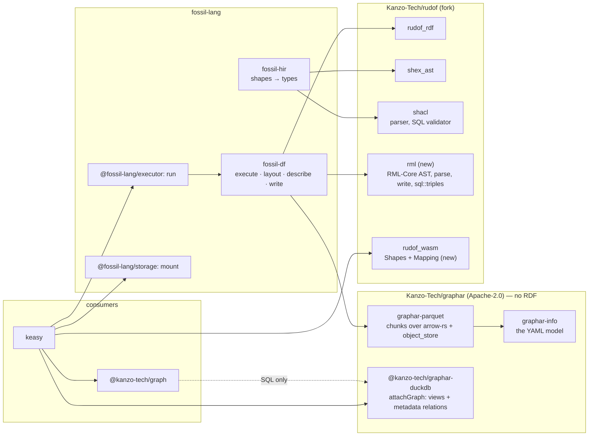

`fossil/1` is fossil's own format: one Parquet file per table under a `fossil.json` that carries the
tables and everything a reader needs to make RDF of them, to count them and to trace them
([the corpus](/docs/design/corpus), [the corpus's own facts](/docs/design/facts)), read back through
`@fossil-lang/corpus`'s `attach`. **This page reverses that, and it is a direction, not yet a fact.**

1. **A run's result is two things, and neither is a component.** The **graph** is an Apache GraphAr
   graph — the YAML infos and the Parquet chunks. Its **description** is standard RDF written in the
   same directory, and only one document of it has a reader today: an RML-Core mapping,
   `mapping.ttl`, which says what the tables mean as RDF.
2. **Each concern has one owner and one mechanism** (below). fossil keeps the language and the
   engine; the encoding of a graph as files goes to graphar, and every parse, write and validation of
   RDF goes to rudof.
3. **`@fossil-lang/corpus` is deleted, and `attach` with it.** `run` does not change.

`fossil.json`, `corpus.bnf`, `cargo xtask corpus`, the manifest's JSON Schema and the `corpus/*`
error codes go with it, and nothing replaces them.

[Discarded](/docs/design/discarded#the-corpus) records why GraphAr was refused: no reader that
fossil's users run spoke it. **This design builds that reader rather than waiting for one** — DuckDB
views over the GraphAr tables, which is exactly where kanzo-ui and keasy read. Everything below was
re-read at `apache/incubator-graphar@06dddb1` (2026-10-10) and its test data at
`apache/incubator-graphar-testing@8286724`; fossil at `b42ace16`, the rudof fork's `master` at
`c727fcf` (workspace 0.3.4), kanzo-ui at `0f42946f` and keasy at `a6d937a`. Every measurement is dated
and says where it ran. Every "after" figure is an estimate, marked ≈.

## Four owners, and one way to do each thing

| concern | owner | the one mechanism |
| --- | --- | --- |
| encoding a property graph as files, and reading those files into DuckDB | **`Kanzo-Tech/graphar`** — knows no RDF | `graphar-info`, `graphar-parquet`, `@kanzo-tech/graphar-duckdb` |
| parsing, writing and validating RDF, ShEx, SHACL and RML, and turning tables into an `(s,p,o)` relation | **rudof, through our fork `Kanzo-Tech/rudof`** | `rudof_rdf`, `shex_ast`, `shacl`, a new `rml` crate, and `Mapping` on `rudof_wasm` |
| the language and the engine | **fossil** | the compiler, and `fossil-df`: execute, `layout`, `describe`, write |
| the global id, and how a graph is drawn | **`@kanzo-tech/graph`** | arithmetic over GraphAr's per-type index |
| composing the above for a product | **keasy** | `mount` + `attachGraph` + `Mapping.triples`, about 20 lines |



**No arrow leaves graphar or rudof towards anything of ours.** graphar knows nothing of fossil, RDF
or Kanzo; rudof's `rml` knows SQL table names and not GraphAr. `@kanzo-tech/graph` imports no package
of either: it reads graphar-duckdb's relations by SQL, through the page's coordinator.

**What would reverse the split.** A concern that two owners both have to implement — that is the
smell the split exists to remove, and it is the test of every row above. Concretely: graphar needing
an RDF word to do its job (then the word is in the wrong repository), or fossil needing to parse or
write RDF itself (then rudof is missing an API, and it goes there).

### graphar: `Kanzo-Tech/graphar`, Apache-2.0

The repository's name is not a crate name. The `graphar` crate on crates.io belongs to a third party
(codeberg.org/nordisk/knut, 0.2.0, on `tokio` and `serde_yaml`), and `graphar-rs` is what Apache's
own `rust/` directory, a `cxx` binding over the C++ library, calls itself. So the crates are named by
what each does, and they are **published at `0.1.0-alpha.1`**: `graphar-info` and `graphar-parquet`
on crates.io, and `@kanzo-tech/graphar-duckdb` on npm under the `alpha` dist-tag. fossil depends on
the crates from crates.io, by version and not by git.

| crate or package | ≈ lines | public API (names) | what it follows |
| --- | ---: | --- | --- |
| `graphar-info` | 900 + 400 tests | `GraphInfo` (`prefix: Option<String>`, `extra_info`), `VertexInfo`, `EdgeInfo`, `PropertyGroup`, `Property` (with `cardinality`), `Cardinality::{Single, List, Set}`, `DataType`, `AdjacentList`, `AdjListType`, `FileType`, `InfoVersion`, `GraphInfo::{load, load_file, dump, file_name, validate}`, `Error`. `dump` answers every document by file name, the graph document last. `extra_info` is carried and never interpreted | Apache's pure-Java `maven-projects/info` module: the same split, the same names |
| `graphar-parquet` | 1,000 + 600 tests | `write_vertices(store, root, &VertexInfo, batches, &Options)`, `write_edges(store, root, &EdgeInfo, adj_list_type, vertex_count, batches, &Options)`, `write_info(store, root, &GraphInfo)` (the commit: every document, the graph document last), `read_vertex_chunk`, `read_adj_list_chunk`, `read_edge_property_chunk`, `read_offsets`, `read_count`, `paths::*`, `Options`, `UserTypes`, `Error`. Takes `&dyn ObjectStore` and `&Options` | C++ `VertexPropertyWriter`, `EdgeChunkWriter` and the Arrow chunk readers; `ParquetObjectWriter`'s own pair of arguments |
| `@kanzo-tech/graphar-duckdb` | 330 + 250 tests | `attachGraph(engine, catalog, resolve, { entry, signal, userTypes })` → `GraphAttachment { catalog, graph: GraphInfo, detach, [Symbol.asyncDispose] }`; `resolve(paths) → names` is handed paths relative to the graph document and answers the names the engine reads them by; `GraphArError`, `VERTEX_INDEX_COL`, `SRC_INDEX_COL`, `DST_INDEX_COL`, `edgeName` | DuckDB's `ATTACH … AS name` and `read_parquet` |
| `conformance/` | 300 | every `*.yml` of GraphAr's testing data loaded and dumped back; every chunk of `ldbc_sample/parquet` read; a graph fossil writes opened by GraphAr's own C++ and PySpark readers | `incubator-graphar-testing@8286724`, pinned as a submodule as GraphAr pins it |

`attachGraph` creates **one view per logical table** — `"<c>"."<type>"` and
`"<c>"."<src>_<edge>_<dst>"` with GraphAr's own columns (`_graphArVertexIndex`, `_graphArSrcIndex`,
`_graphArDstIndex`) — and **metadata relations in GraphAr's words**, five:

| relation | columns |
| --- | --- |
| `graphar_vertex_types` | `type`, `count`, `ordinal` |
| `graphar_edge_types` | `name`, `src_type`, `edge_type`, `dst_type`, `count`, `directed`, `ordinal` |
| `graphar_properties` | `type`, `property`, `data_type` (as written), `is_primary`, `is_nullable`, `ordinal`, `cardinality` (`single`, `list` or `set`) |
| `graphar_extra_info` | `key`, `value` — the graph document's `extra_info`, in order; fossil writes none, so it is empty |
| `graphar_chunks` | `type`, `kind`, `path` — the data file behind each chunk, as the engine names it, so a reader of a Parquet footer needs no path arithmetic of its own |

Counts are `UBIGINT`. `ordinal` is the order of the YAML lists, which is what makes the global id stable (below).

**A user-defined type has no storage in GraphAr, so its Arrow type comes from the caller.** The writer
takes `Options { props, user_types }`, where `user_types` maps a declared name to its Arrow type
(`langString` to `Struct<value: Utf8, lang: Utf8>`), and a column must match its entry exactly;
`attachGraph` takes the same as a `userTypes` option, in DuckDB's spelling, and needs it only to type
a view with no rows, since a view over chunks reads its type from the Parquet file. The
relations are a SQL projection of `GraphInfo`, so they are one fact and not a second document; they
exist because kanzo-ui reads its catalog through mosaic's coordinator, with its cache and queue, and
keasy's overview is SQL.

**Two rules of the YAML that graphar-info settles, and the writer follows.** The graph document
**omits `prefix`**: GraphAr's C++ library resolves a relative one such as `./` against the process's
working directory, where `attachGraph` resolves it against the document, so a written `prefix` is a
path two readers read differently; omitted, the data is under the document, which is GraphAr's default
and the same for both. And block sequences are **indented under their key**, as `dump` writes them:
C++'s mini-yaml reads them no other way. `graphar-info` refuses a key GraphAr does not define
(`deny_unknown_fields`) rather than reading or dropping it.

**The reader is DuckDB views plus a YAML parse, not a WASM module.** GraphAr's YAML has three document
shapes of a dozen keys each; the views are `read_parquet` over the paths the YAML yields. A Rust
reader exists anyway, in `graphar-parquet`, for the conformance suite and for any native host.

**What would reverse publishing it as ours.** Apache GraphAr taking the code: then `graphar-info` and
`graphar-parquet` move into `apache/incubator-graphar` and fossil depends on the Apache crates. That
is the intended end, offered **after fossil runs on graphar**, so the code is proven before it is
reviewed. The real reversal is a GraphAr that stops being maintained first — no release, a podling
retired — and then the crates are ours to keep.

### rudof: our fork, `Kanzo-Tech/rudof`

fossil consumes rudof **from our fork, by git `rev`**, as keasy's server already does; `deny.toml`
gains the fork under `allow-git`. F0 pins the merge commit of R-c, `9ff79986e4ed711c1ee70e5cfa1cc73358a0af45`,
until a newer tag exists; the tag `v0.3.5-kanzo.1` points at the R-a commit, which is older. Its npm half stays `@kanzo-tech/rudof-wasm`. Offering the changes
to upstream rudof is optional and later.

| change | what | ≈ size | why |
| --- | --- | ---: | --- |
| R0 | `rudof_rdf`'s native `oxigraph` and `tokio` become optional, behind `sparql` | 6 | a `default-features = false` consumer still compiles oxigraph and a full tokio |
| R1 | `rudof_iri`'s native `reqwest` becomes optional, behind `fetch`; `rudof_lib` and `rudof_cli` turn it on | 30 | blocking `reqwest` brings a tokio runtime into every native consumer; fossil already avoids `Schema::from_iri` for that reason |
| R2 | wasm32 CI over `shex_ast`, `shacl` and `rml`, plus a `cargo tree --target wasm32-unknown-unknown -i tokio` that must find nothing | 15 | CI checks only `rudof_wasm` and `shacl`; `shex_ast` is unchecked |
| R-c | the ASTs carry what fossil reads: `extra()`, `sh:order`, and `sh:name` and `sh:description` on shapes; and `ASTSchema` is a `BTreeMap`, so the walk is deterministic (rudof fork PR #33). Merged | — | the order of shapes needs `sh:order`, and a deterministic walk is the order's last tie-break |
| R3 | **new crate `rml`**: the RML-Core AST (`Mapping`, `TriplesMap`, `LogicalSource`, `SubjectMap`, `PredicateObjectMap`, `TermMap`, `LanguageMap`, `RefObjectMap`); `rml::rdf::{parse, write}` over `rudof_rdf`; and feature `sql`: `rml::sql::triples`, a sqlparser query in the DuckDB dialect producing **exactly** the seven columns `shacl`'s SQL validator reads | 1,250 + 600 tests | parsing, writing and executing RDF is rudof's; the seven-column relation then has its producer and its consumer in one repository |
| R4 | **`Mapping` on `rudof_wasm`**: `Mapping.parse(text, { base? })`, `mapping.triples({ engine, into, tables, signal })`, `mapping.model()` (per logical table: class and annotations; per column: predicate, term type, datatype, language column, annotations). Published as `@kanzo-tech/rudof-wasm` 0.5 | 200 | keasy's rules page already loads rudof lazily, and reads the mapping in the same load |

**The `rml` crate lives in the fork** (D8), not a repository of its own: it shares `rudof_rdf`,
`sqlparser`, the DuckDB dialect and the triples columns with `shacl::validator::sql`. It sits
*beside* that validator and not inside it, because the validator's own documentation says it "knows
no mapping language and no product vocabulary".

**The condition [incremental](/docs/design/incremental) sets for moving fossil's SHACL decoder to
rudof is met on the fork's `master`:** `shacl` and `shex_ast` are both on 0.3.4, `rudof_iri` takes no
`reqwest` on wasm32, and the workspace pins `rudof_rdf` with `default-features = false`. So F0 (below)
moves it, and replaces that page's "SHACL stays fossil's own walk" with the sentence that replaces it.

### fossil

fossil keeps two things of the RDF world and no more: **lowering** a shape to a fossil type (the type
system) and **choosing** the IRIs a mapping states (the program). The parse is rudof's in both
directions.

| crate or package | now | ≈ after | what changes |
| --- | ---: | ---: | --- |
| `fossil-syntax`, `fossil-base`, `fossil-mir`, `fossil-ide`, `fossil-wasm`, `@fossil-lang/wasm`, `codemirror-fossil` | — | — | nothing |
| `fossil-hir` | 21,244 | 20,880 | `shacl.rs` 624 → ≈260: it walks rudof's `ASTSchema` from `ShaclParser` into `OutputShapes`, and `oxttl`/`oxrdf` leave the crate. `shex.rs` keeps `shex_ast`. The `providers` registry is unchanged: the names are fossil's, the parse each calls is rudof's |
| `fossil-df` | 6,403 | 5,680 | the writer through `graphar-parquet` (678 → ≈430); **new `layout` (≈150) and `describe` (≈250)**; `corpus::*` gone (−604); `facts.rs` writes the Parquet footers (D2); `rdf.rs` on `rudof_rdf`'s parser; ids numbered per type |
| `fossil-df-wasm`, `@fossil-lang/executor` | 407 / 582 | same | `run` unchanged; it receives the integration tests (run → `attachGraph` → assert, ≈400 lines) |
| `fossil-storage` (+ `-wasm`), `@fossil-lang/storage` | — | same | `mount` gains hosts as its callers |
| `@fossil-lang/types` | 720 | 690 | the whole `corpus/*` area goes; **`write/unrepresentable`** is added |
| `@fossil-lang/corpus` | 622 src + 1,258 tests + 1,559 contract | **0** | deleted |
| `corpus.bnf`, `xtask corpus` | 131 + 530 | 0 | deleted |

### `@kanzo-tech/graph`, and keasy

**`@kanzo-tech/graph` reads GraphAr directly.** Its `readCatalog` reads `graphar_vertex_types`, `graphar_edge_types`, `graphar_properties` and, for the statistics, `graphar_chunks`; the
global id is its own arithmetic; an edge's label is GraphAr's `edge_type`, so the string surgery that
cut it out of `<src>_<label>_<dst>` goes. Every vertex type fossil writes has a primary key, so every one is a node (D3). Nothing on the
graph page parses RDF before the first paint (D4).

**keasy composes** what `attach` used to hide: `mount` for the credential, `attachGraph` for the
tables, and `Mapping.triples` for the `(s,p,o)` relation, built only on the rules page.

## What a run writes

`fossil_df::Executor`, `fossil-df-wasm` and `@fossil-lang/executor`'s `run` do not change shape. A run
reads its sources through the host's credentials, executes under the 2 GiB pool, and calls
`crates/fossil-df/src/write.rs, write`. It answers `{ location, dropped }`, or `{ report, files }`
for a run into memory. **The only thing that changes is what is under `location`.**

```
<location>/
  fossil.graph.yml                         GraphAr graph info — written LAST: the commit
  Person.vertex.yml, Order_placedBy_Person.edge.yml, …     GraphAr infos      (graphar-info)
  vertex/Person/…/chunk0, vertex_count, edge/…/adj_list/…, offset/…, edge_count0   (graphar-parquet)
  mapping.ttl                              RML-Core: what the tables mean as RDF   (describe → rudof rml::rdf::write)
```

**Written together, once.** A generated graph is OLAP: written once and read many times. So the
tables, the mapping and every count are written in one pass by the run that knows them, and nothing
moves or rewrites them after. The commit order is fossil's: tables, then `mapping.ttl`, then
`fossil.graph.yml` last — GraphAr defines no commit, and the graph YAML's presence is the reader's
sign that the rest is there.

**The entry and the mapping have fixed names, documented in [the format](/docs/format), and no
pointer joins them** (D5). The graph is named `fossil`, so its info is `fossil.graph.yml`; the mapping
is `mapping.ttl` beside it. The graph YAML carries **no `extra_info` entry** for the mapping: the two
are serialised together and never move apart, so a pointer would be a second statement of a fact the
directory already states, and one more key a GraphAr reader must ignore. `RunReport` stays
`{ location, dropped }`.

**What would reverse the fixed names.** Two graphs under one location, or a mapping that has to live
somewhere other than beside its graph. Then the graph YAML names it — in `extra_info`, keyed by the
vocabulary's namespace IRI (`http://w3id.org/rml/`), never by a fossil word — or `RunReport` gains the
entry.

### The result, as a type

```rust
// fossil-df, after (names only; Executor::execute is unchanged)
pub struct Description { pub mapping: rml::Mapping }   // + shapes, lineage, the day each has a reader
pub fn layout(schema: &GraphSchema) -> graphar_info::GraphInfo;                 // pure
pub fn describe(schema: &GraphSchema, graph: &graphar_info::GraphInfo) -> Description;  // pure: no data, no db
```

The description is built in `fossil-df::describe` **with rudof's AST types**, and rudof's writer
serialises it. **There is no `fossil-rdf` crate.** The mapping (and, the day they are emitted, the
shapes and the lineage) is a pure function of `GraphSchema`, the layout and what the program read;
none of it reads data, and it is written in the same pass as the tables it describes — so it lives in
the module that writes those tables (D6). That is the pattern OpenLineage's integrations follow,
emitting lineage from the run and keeping no lineage component, and dbt's, whose `manifest.json` is an
artefact of `dbt run`.

**What would reverse it.** A host that needs the description **without running** — the editor
showing the mapping a program will produce. Then `layout` and `describe` move to `fossil-mir`, beside
the assembly of `GraphSchema`, and the editor's wasm links `rml`; that size is measured first
(`fossil_df_wasm_bg.wasm` is 24.3 MB and `rudof_wasm_bg.wasm` 7.45 MB in keasy's `node_modules`).

### `examples/hello.fossil`, the walking skeleton

These files were written by a pyarrow prototype of the layout on 2026-10-14; the byte sizes are the
prototype's.

```
<location>/
  fossil.graph.yml                       GraphAr graph info, written last
  Person.vertex.yml                      GraphAr vertex info
  vertex/Person/vertex_count               8 B   int64, GraphAr's count file
  vertex/Person/subject_name/chunk0    1,489 B   Parquet: _graphArVertexIndex int64, subject, name
  mapping.ttl                                    RML-Core
```

```yaml
# fossil.graph.yml
name: fossil
vertices:
  - Person.vertex.yml
version: gar/v1
```

```yaml
# Person.vertex.yml
type: Person
chunk_size: 5
prefix: vertex/Person/
property_groups:
  - prefix: subject_name/
    file_type: parquet
    properties:
      - name: subject
        data_type: string
        is_primary: true
      - name: name
        data_type: string
        is_primary: false
        is_nullable: false
version: gar/v1
```

```turtle
# mapping.ttl
@prefix rml: <http://w3id.org/rml/> .
@prefix xsd: <http://www.w3.org/2001/XMLSchema#> .

<#Person> a rml:TriplesMap ;
  rml:logicalSource [ rml:referenceFormulation rml:SQL2008Table ; rml:iterator "Person" ] ;
  rml:subjectMap [ rml:reference "subject" ; rml:termType rml:IRI ;
                   rml:class <https://example.org/Person> ] ;
  rml:predicateObjectMap [ rml:predicate <https://example.org/name> ;
                           rml:objectMap [ rml:reference "name" ; rml:datatype xsd:string ] ] .
```

The logical sources are SQL table names, which the host resolves when it builds the relation
(`tables:` in `Mapping.triples`). **The walking skeleton reads it back:** on DuckDB-WASM 1.4.3 the
prototype returned the five rows `(0, https://example.org/user/1, Alice)` to
`(4, https://example.org/user/5, Eve)`. The invariant in `CLAUDE.md` holds with one word changed —
"a GraphAr graph" for "a `fossil/1` corpus": five `Person` vertices, asserted by content read back
with DuckDB. `crates/fossil-df/tests/walking_skeleton.rs` opens the chunk `Person.vertex.yml` names,
through `attachGraph`'s view, and **is rewritten in the same PR as the writer**, so it is never red.

### The shapes and the lineage: not emitted until a reader exists

| option | works for | fails on | verdict |
| --- | --- | --- | --- |
| **Pass the program's input shape document through** | a program that imports every shape of one document, unrenamed | `docs/programs/multi-document` (two documents, `Person as Human`); `docs/programs/declared` (`@iri` types with no document, beside an import); mixed ShEx and SHACL inputs. And `fossil-hir`'s SHACL decoder ignores `sh:pattern`, `sh:sparql` and severities on purpose, so a passed-through document would assert a conformance nobody checked | **no** — an input is provenance, not the output's contract |
| **Generate SHACL from `GraphSchema` through rudof** | every program, uniformly | — | feasible: rudof's `NodeShapeBuilder` and `PropertyShapeBuilder`, `IRSchema::compile` and `ShaclWriter` already exist |
| **Emit nothing until a reader exists** | — | — | **taken** (D1) |

**The annotations are a different matter, and they are read.** kanzo-ui's `RelationPicker` and
Ask's `typeWords` name a type, a column and a relation by `rdfs:label`, through `labelOf`, in the
page's language; today the graph gets them from `fossil_annotations`. After this design they come
**from the mapping and not from GraphAr**: GraphAr has no word for them, and `mapping.ttl` is where
the program's IRIs already are. So the mapping document also carries the program's annotations as
plain triples about the class and predicate IRIs it names (`<https://example.org/Person> rdfs:label
"Person"@en`), written by the same `describe` with the same writer, and rudof's `Mapping.model()`
answers them per table and per column beside the class, predicate and datatype. **Until R-b ships
`Mapping.model()` and the host passes it, the picker and Ask fall back to the names** — the type's
and the column's own — and nothing else changes. Nothing reads `derived_from`, `candidate_keys` or
the program's structural shapes (a grep over kanzo-ui and keasy finds none), and keasy's rules are
the *user's* SHACL, not the program's: validating a graph against the program's own shapes would be a
tautology the checker already proved.

**What would reverse it.** The first reader of the output's contract — keasy seeding rules from the
program's shapes, or the graph showing `sh:name` labels — or of `derived_from`. Then `Description`
gains `shapes`, **generated from `GraphSchema` with rudof's builder and writer, never passed
through**, written as a fixed-name file beside `mapping.ttl`. Lineage follows the same rule: PROV-O's
`prov:wasDerivedFrom` when an RDF reader appears, or an OpenLineage `RunEvent` if the reader is a
Marquez or a DataHub.

### Is the mapping needed?

Yes. It has two readers: kanzo-ui's labels and datatypes, through `Mapping.model()`, and keasy's rules validation, which hands rudof's SQL SHACL validator a seven-column
`(s,p,o)` relation. The ways of getting that relation without a mapping are each worse:

- **The W3C Direct Mapping** mints IRIs from table and column names, not the program's IRIs: the
  wrong meaning.
- **Materialising N-Triples** at run time is a second copy of the data, and the two can disagree.
- **Validating the tables as a property graph** (PG-Schema; rudof has a `pgschema` crate) is not
  SHACL, and keasy's rules are SHACL documents; SHACL → PG-Schema is no standard.
- **A virtual graph over a mapping** is the remaining way: `rml::sql::triples` produces a *view*
  that rudof's SQL validator reads, nothing is materialised, and DuckDB's optimiser does the
  unfolding.

**Who owns "tables → RDF" is split by what each party knows.** The *content* — which class,
predicate, term type, datatype and language column — is the program's, so fossil's run writes it. The
*mechanism* — parsing, writing and rendering RML to a relation — is rudof's. graphar has no part in
it.

### R2RML or RML-Core

| feature | W3C R2RML (Recommendation, 2012) | RML-Core (KG-Construct CG draft, 2026-03-16) |
| --- | --- | --- |
| subject from a column or a template | `rr:column`, `rr:template` | `rml:reference`, `rml:template` |
| `IRI` or `Literal` | `rr:termType` | `rml:termType` |
| a typed literal (`xsd:gYear` over `int32`) | `rr:datatype` | `rml:datatype` |
| an edge: subject and object from two tables | `rr:sqlQuery`, or `rr:parentTriplesMap` with `rr:joinCondition` | `rml:SQL2008Query`, or `rml:parentTriplesMap` with `rml:joinCondition` |
| **a language tag read from a column** | **no**: `rr:language` is a constant | **yes**: `rml:languageMap` |

**RML-Core, because the language column decides it.** fossil writes `rdf:langString` values with the
tag read per row, which only RML-Core can express; it "follows exactly the same syntax as R2RML", so
one vocabulary does the whole document. The price is a Community Group draft, not a Recommendation.
Only RML-Core is used: RML-LV's logical views stay [discarded](/docs/design/discarded#the-corpus-as-rdf),
and joins are SQL2008 queries.

**What would reverse it.** A W3C R2RML revision with a language map, or a downstream consumer that
runs R2RML only and refuses RML; then the tag is folded into a constant per table.

## Ids: GraphAr's per type, and the global id is the graph's

GraphAr numbers vertices **within a type**: each vertex chunk carries `_graphArVertexIndex` as
`int64`, and edges carry `_graphArSrcIndex` and `_graphArDstIndex` into their source and destination
types. Those names are in GraphAr's libraries, not its specification. kanzo-ui needs one id across the
graph, because it is a GPU buffer index, and mosaic's cross-type semi-join (`dense_id IN (…)`) needs
one id space.

**The files carry GraphAr's ids only. The global id is `@kanzo-tech/graph`'s arithmetic, and nothing
writes it:**

```
first(t) = Σ count of the node types before t, in graphar_vertex_types.ordinal
dense_id = first(t) + _graphArVertexIndex          cast to UINTEGER
```

**This is a prefix sum, and it is injective only if every type's indices are contiguous**: type
`t`'s indices must be exactly `0 … count_t − 1`, or the ids of `t` reach into the range of the type
after it. GraphAr does not promise that. Its specification says a vertex's index starts from 0 and
corresponds to the row number in the logical vertex table, in "continuous" chunks; the GraphAr paper
(PVLDB 18(3), §3.1) says the internal ids of partition *i* start at `partition_size × i` and that
"bubbles are allowed at the end of each partition", so the actual rows may be fewer than the
partition size and the index space then has gaps. The specification and the paper disagree, and a
foreign writer may follow the paper. Three rules follow, each ours:

1. **Our writer is contiguous by construction**: one chunk per table, rows numbered from 0.
2. **`attachGraph` checks it.** For each node type it requires `count == max(_graphArVertexIndex) + 1`
   (the vertex count file against the largest index in the chunks), and refuses a graph with a gap
   as `invalid`, before any view is made. A graph with bubbles is not read by the global-id
   arithmetic, and is not silently misnumbered. This ships in `@kanzo-tech/graphar-duckdb`
   `0.1.0-alpha.1`.
3. **`ordinal` is our rule.** The specification gives the order of `vertices:` in the graph document
   no meaning, and whether GraphAr's Java loader keeps it is not established (its `GraphInfo` constructor
   takes a `Map`).
   So `graphar_vertex_types.ordinal` is the position in the document **`attachGraph` read**, and
   the writer writes `vertices:` in the order defined in [the order of shapes](#the-order-of-shapes).
   `ordinal` is the whole of the id's stability, and it is a convention of fossil's writer and of
   `attachGraph`, which a GraphAr reader is free to ignore.

**The global id is not stable under change.** A prefix sum shifts: adding a row to an early type
renumbers every later type's global ids. That holds for the id the GPU buffer uses and not for the
files, where a new subject renumbers only the vertices after it in its own type. It is harmless while
the id is regenerated on every attach, and wrong for anything that persists one; nothing does.
Systems that need a stable global id carry the type in it: MillenniumDB's 8-byte identifiers put a
class in the first byte, so an identifier is `(class, local index)` and depends on no other class's
size, at the cost of not being dense (Vrgoč et al. 2023). The GPU buffer needs the dense one.
Other RDF stores keep a dictionary that assigns each term a unique id and store only id triples
(RDF-3X, Neumann and Weikum 2008; HDT, Fernández et al. 2013); there, as here, the id is internal
and the identity is the IRI.

Each vertex type's table in the graph's `JoinGraph` is a query projecting that `dense_id` and the
program's columns; edges add `first(src_type)` and `first(dst_type)` to their indices. The reserved
`_graphAr*` columns never reach `useFieldStats`. **`run/too-large` stays at 2³² vertices in total**, so
the cast always fits.

**Measured on 2026-10-14.** DuckDB-WASM 1.32.0 (DuckDB v1.4.3) in Node, blocking bindings, one
thread, local files, a shared 4-core host at load average 8.4; 1,000,000 vertices and 2,000,000
distinct random edges sorted by `(src, dst)`, written by pyarrow with fossil's writer settings (ZSTD
level 3, 122,880-row groups, `DELTA_BINARY_PACKED` on the sorted key). Two runs of seven reads each,
best and median:

| read, as Arrow | `fossil/1` | GraphAr, raw `int64` | GraphAr through the arithmetic, cast |
| --- | --- | --- | --- |
| edges `src, dst`, 2M | 157 / 205 ms; 134 / 172 ms | 165 / 232 ms; 171 / 256 ms | 152 / 183 ms; 164 / 201 ms |
| Arrow held | 16.0 MB | **32.0 MB** | 16.0 MB |
| vertex ids, 1M | 21 / 25 ms; 25 / 33 ms | — | 24 / 26 ms; 28 / 39 ms |

| on disk | `fossil/1` | GraphAr |
| --- | --- | --- |
| vertex file: id + `subject` | 1.02 MB | 1.03 MB |
| edge file: `src, dst` | 10.33 MB | 10.62 MB (+2.8%) |
| offsets: `ordered_by_source`, V+1 `int64` | — | 0.36 MB |

**The arithmetic costs nothing this host can resolve, and the cast keeps the Arrow at 16 MB.** It
also corrected two claims, and the pages that made them now say what was measured: `uint64` does not
double the column on disk (delta-encoded, 1–3%) — what doubles is the memory of a reader that does not
cast; and the 4.0 MB figure for `dense_id` at a million vertices was PLAIN encoding, which the writer
left in `acf5da82`.

Neither id is an identity; the identity is still `subject` ([identity](/docs/design/identity)).

**What would reverse it.** A reader that needs global ids **in the files**, with no query between it
and them; then a `dense_id` property is written beside GraphAr's index, and the page that adds it says
who checks the two agree. Or the arithmetic measured above 20% of a read on a quiet host. Or a use
that persists a global id: then it is `(type, index)`, which depends on no other type.

## The order of shapes

**No order among shapes comes from the standards.** A SHACL shapes graph is an RDF graph, "zero or
more shapes" (SHACL §3.1), and an RDF graph is a set (RDF 1.1 Concepts §3). `sh:order` is the only
ordering SHACL has: it sits in a non-normative section (§2.3.2), applies to property shapes and
groups "for purposes such as form building", and "is not used for validation purposes"; SHACL 1.2
Core (Working Draft, 14 October 2026, §8.7) keeps it so. The members of an `sh:and` or `sh:or` list
are in an order that "does not impact the validation results". ShEx 2.1 annotations "do not affect
whether a node conforms" (§5.9). A document therefore has no declaration order that means anything,
and a rule that reads one makes a program's output depend on how a file was laid out.

**fossil defines the order explicitly, and it is not the document's.** The order of the shapes a
program imports, and so of the vertex types it writes, is the order of this key, compared in turn:

1. `sh:order` ascending, where the shape has one; a shape without one after every shape with one.
   SHACL defines `sh:order` for property shapes and groups, so using it on a node shape is fossil's
   extension, and a ShEx shape, which has none, goes to the next criterion.
2. The shape's IRI, compared as the string it is, code point by code point (RDF 1.1 Concepts §3.2:
   IRI equality is string comparison, so the comparison is defined).
3. A shape that is a blank node has no IRI, and a blank node's label is not part of RDF's abstract
   syntax (§3.4), so it is placed after the shapes with an IRI, by the sorted IRIs of its
   `sh:targetClass` values and then of its property paths.
4. A tie that survives all three is a compile error naming both shapes, and not a choice.

Declared types (`@iri`, no document) take the same key, by their class IRI. This replaces the rule
that read the document's order. It is a **deliberate behaviour change in F0**, and it changes two
visible things: the order of the vertex types in `fossil.graph.yml` (and so the global id), and the
members the error [`shape/not-in-document`](/docs/errors/shape/not-in-document) lists. A program that
names every shape it uses does not change.

**What would reverse it.** A standard giving node shapes an order that validation or construction
may rely on (a SHACL revision making `sh:order` normative for node shapes), at which point step 1
is that standard's. Or a program for which an author-chosen order of types is data: it then states
the order in the program, not in a document.

## A relation, and a multi-valued property

The conformance fixture's `Order_placedBy_Person` (75 orders, 300 people) becomes:

```
edge/Order_placedBy_Person/ordered_by_source/adj_list/part0/chunk0   _graphArSrcIndex, _graphArDstIndex
edge/Order_placedBy_Person/ordered_by_source/offset/chunk0           _graphArOffset, V_Order + 1 rows
edge/Order_placedBy_Person/ordered_by_source/edge_count0             int64
Order_placedBy_Person.edge.yml
```

```yaml
src_type: Order
edge_type: placedBy
dst_type: Person
chunk_size: 75
src_chunk_size: 75
dst_chunk_size: 300
directed: true
prefix: edge/Order_placedBy_Person/
adj_lists:
  - ordered: true
    aligned_by: src
    prefix: ordered_by_source/
    file_type: parquet
version: gar/v1
```

**Every chunk size is at least the table's row count, so every table is one chunk** — `fossil/1`'s
"one file per table" in GraphAr's terms. The offset table follows the specification and not C++'s
padding: its last chunk is **as long as its vertex chunk, plus one** (`write_edges` takes the
`vertex_count` for it), the alignment `ldbc_sample/parquet` is written with.

**A multi-valued property is a property of the vertex type that owns it, with `cardinality: set`**
(D3). A language-tagged one is one column whose element type is `langString`, a GraphAr
user-defined type. `Person.vertex.yml` declares it, and the version line names the type it uses:

```yaml
property_groups:
  - prefix: subject_name_nickname/
    file_type: parquet
    properties:
      - name: subject
        data_type: string
        is_primary: true
      - name: nickname
        data_type: langString
        cardinality: set
version: gar/v1 (langString)
```

`langString` is `STRUCT<value: STRING, lang: STRING>`, and `cardinality: set` makes the column a
`LIST` of it: Parquet's three-level `LIST` annotation over a group, which Parquet's `LogicalTypes.md`
allows to hold nested structures, and Arrow's `List<Struct<value: Utf8, lang: Utf8>>`. GraphAr's C++
writer already wraps any property whose cardinality is not single in `arrow::list(…)`, so the
declaration `data_type: langString` with `cardinality: set` is one level of list, not two. An untagged
multi-valued property is the same with `data_type: string`. A single-valued tagged property is
`langString` with no cardinality, a bare struct. `graphar-info` carries `gar/v1 (langString)`
(`InfoVersion`), and `attachGraph` takes the DuckDB type for a view with no chunk to read through
its `userTypes` option, `{ langString: 'STRUCT(value VARCHAR, lang VARCHAR)' }`.

**Why `set`.** An RDF graph is a set of triples (RDF 1.1 Concepts §3; RDF 1.2 keeps it), and an
R2RML output dataset is an RDF dataset (R2RML §11), so several objects for one predicate are an
unordered set without duplicates. The one property-graph model that has multi-valued properties is
set-valued (Angles 2018, Def. 1, `σ : (N ∪ E) × P → SET⁺(V)`); the others give one value per key
(Angles et al. 2017, Def. 2.3; PG-Schema Def. 3.1, which takes `SINGLE`, `LIST` and `SET` from
JanusGraph's key cardinalities and adds arrays as an extension). Hartig's formal translation of
property graphs to RDF-star assumes a value-to-literal mapping that, in his words, rules out property
values of a collection data type. GraphAr has `Cardinality::{Single, List, Set}` in its libraries, and
the Java source documents `set` as "no duplicates"; the specification page does not mention
cardinality at all. **`list` is rejected**: it declares an order and a multiplicity that
the RDF image cannot hold, so the mapping would silently discard what the files promise.

**The writer refuses duplicates**, as `write/duplicate-value`: two elements of one set are
duplicates when they are the same RDF term, which for a tagged value is the same lexical form with
the same tag after the tag is lower-cased (RDF 1.1 Concepts §3.3 puts language tags in lower case,
and RDF 1.2 §3.4 compares them ASCII case-insensitively). A NULL element is refused the same way. The
writer lower-cases the tag it writes, and a malformed one is `write/invalid-language-tag`, as today.
RDF 1.2 adds a base direction (`rdf:dirLangString`), which a `(value, lang)` pair cannot carry; it is
not written.

The mapping unnests the column once, and so cannot misalign a value and its tag:

```turtle
<#Person_nickname> a rml:TriplesMap ;
  rml:logicalSource [ rml:referenceFormulation rml:SQL2008Query ;
    rml:iterator "SELECT subject, n.value AS value, n.lang AS lang FROM (SELECT subject, unnest(nickname) AS n FROM Person)" ] ;
  rml:subjectMap [ rml:reference "subject" ; rml:termType rml:IRI ] ;
  rml:predicateObjectMap [ rml:predicate <https://example.org/nickname> ;
    rml:objectMap [ rml:reference "value" ; rml:languageMap [ rml:reference "lang" ] ] ] .
```

**A known departure from the reference readers.** The specification permits this: it "supports the
user-defined data types, which can be used to represent complex data structures, such as the struct,
map, and union types". The reference readers do not. Read at `apache/incubator-graphar@06dddb1` on
2026-10-14:

- C++ `DataType::TypeNameToDataType` (`cpp/src/graphar/types.cc`) accepts `bool`, `int32`, `int64`,
  `float`, `double`, `string`, `date`, `timestamp` and `list<>` of `int32`, `int64`, `float`,
  `double` or `string`, and throws `Unsupported data type` for any other name.
- C++ `DataType::DataTypeToArrowDataType` and `ArrowDataTypeToDataType` throw "is not supported yet
  in GraphAr" for every type outside that set, a user-defined one and an Arrow struct included.
  `USER_DEFINED` is only a name string (`ToTypeName` returns it), so the C++ type has nowhere to say
  what the struct holds.
- Java `DataType.fromString` (`maven-projects/info`) accepts the same eight scalars and `list<…>` of
  them, and throws `IllegalArgumentException("Unknown data type: …")` for any other name.

So **a graph with a `langString` property is not opened by GraphAr's C++ and Java readers at that
revision**, and the claim "a GraphAr reader opens the tables" holds for it only for readers that
follow the specification's user-defined-type clause: `graphar-info` and `@kanzo-tech/graphar-duckdb`.
The owner chose this knowing it, because the alternative either loses the tag or admits a
misaligned state ([the parallel-list encoding](/docs/design/discarded#the-corpus-as-apache-graphar) is discarded for it). A graph with no tagged multi-valued property uses only
built-in types and every reader opens it. The conformance job's C++ and PySpark readers therefore
open the graphs without a `langString` property; the property is tested through `graphar-duckdb`.

**What would reverse it.** The C++ and Java readers accepting a struct element type, or an upstream
proposal for a tagged-string type merged into GraphAr (then the type takes GraphAr's name and
`langString` goes). Or a reader our users run, that refuses a user-defined type, having to open such
a graph: then the tag is dropped from that graph's files (`set` of `string`), and the tag stays in
the mapping's constant `rml:language` where one language is all a column holds.

**What would reverse `set`.** A downstream consumer for which order is data: then the order is
carried by an index-carrying element or an `rdf:List`, which RML-Core has no construct for (its
contents have no collection section), so it is a different design and not a flag.

**What would reverse the edge layout.** Offsets measured as a cost on a write or a read that matters:
then `ordered: false` (COO), and the `(src, dst)` sort is checked only by a test.

## Statistics: counted once, at write

**Column statistics are kept** (D2). A generated graph is written once and read many times, so each
column is counted once, by the writer, on batches it already holds — not by every reader at every
open. They have a reader: kanzo-ui's `readCatalog` and `useFieldStats` (kanzo-ui PR #218) use them
in place of `SUMMARIZE`.

They go **in each chunk's own Parquet footer**, which is the one place a Parquet reader already looks:

- `null_count`, `min_value` and `max_value` in the column chunks' `Statistics`, with
  `is_min_value_exact` / `is_max_value_exact`;
- the distinct count and the most common values with their frequencies in the file's
  `key_value_metadata`, under the key **`fossil:stats`**, because Parquet has no field for them.

**This is fossil's convention, not GraphAr's and not Parquet's.** `parquet.thrift` gives the file
metadata (`FileMetaData.key_value_metadata`) and each column chunk's (`ColumnMetaData.key_value_metadata`)
a list of string keys and string values, and names none; Arrow uses the file-level one for its own
`ARROW:schema`. The `fossil:` prefix namespaces the key the way `ARROW:` does, and the value is this
document, versioned, and checked by the writer's tests:

```json
{
  "$schema": "https://json-schema.org/draft/2020-12/schema",
  "type": "object",
  "required": ["version", "columns"],
  "additionalProperties": false,
  "properties": {
    "version": { "const": 1 },
    "columns": {
      "type": "object",
      "additionalProperties": {
        "type": "object",
        "required": ["distinct_count"],
        "additionalProperties": false,
        "properties": {
          "distinct_count": { "type": "integer", "minimum": 0 },
          "most_common_vals": { "type": "array", "maxItems": 10, "items": { "type": "string" } },
          "most_common_freqs": { "type": "array", "maxItems": 10, "items": { "type": "number", "exclusiveMinimum": 0, "maximum": 1 } }
        }
      }
    }
  }
}
```

`columns` is keyed by the property's name. `most_common_vals` and `most_common_freqs` are two arrays of
the same length, as PostgreSQL's `pg_stats` has them: the ten most frequent non-null values that occur
at least twice, most frequent first and ties by value, each as the column type's text, and each one's
share of the chunk's rows. They are absent when no value repeats. A set column's `distinct_count` and
values count its **elements**, since Parquet counts leaf values; a candidate key is read from
single-valued scalar columns only. A reader that does not know the key loses nothing a Parquet reader
needs; one that does checks `version` and refuses another.

**Why `key_value_metadata` and not `Statistics.distinct_count`.** Parquet's statistics are per row
group: `null_count` sums and the bounds fold, but a distinct count does not combine, and the arrow-rs
`ArrowWriter` (`parquet` 58.3.0) writes none — `distinct_count` reaches a chunk only through
`write_batch_with_statistics`, and only if nothing else wrote to it. Nor is the reason only the
writer's: `null_count` is a count and `min_value` and `max_value` are a minimum and a maximum, which
combine across row groups by sum, minimum and maximum — the *distributive* aggregates of Gray et al.
— while a distinct count over a union cannot be computed from the per-group ones (that it is
*holistic* is our reading of their definition, which does not name it). `key_value_metadata` is the slot
Parquet gives facts it has no field for, and the one Arrow itself uses (`ARROW:schema`). arrow-rs
truncates a bound at 64 bytes and marks it inexact, so a reader that keeps only exact bounds never
shows a cut value — the rule [the corpus's own facts](/docs/design/facts) already states.

**The graph reads them itself.** `@kanzo-tech/graph`'s `readCatalog` and `useFieldStats` take the
counts from the footers with DuckDB's own table functions, over the paths `graphar_chunks(type, kind,
path)` answers, with no fossil code and no `SUMMARIZE` — measured on DuckDB-WASM 1.4.3 on
2026-10-14 over the hello chunk at 27 ms and 5 ms:

```sql
SELECT path_in_schema, row_group_id, stats_null_count, stats_min_value, stats_max_value,
       min_is_exact, max_is_exact
FROM parquet_metadata((SELECT list(path) FROM graphar_chunks WHERE type = 'Person' AND kind = 'vertex'));

SELECT key::VARCHAR, decode(value)
FROM parquet_kv_metadata((SELECT list(path) FROM graphar_chunks WHERE type = 'Person' AND kind = 'vertex'));
```

The candidate keys are not stored. A reader derives them: `is_primary`, plus every column with
`null_count = 0` and `distinct_count = count` whose GraphAr type can be a key (`int32`, `int64`,
`string`, `date`, `timestamp`).

**What would reverse it.** A Parquet release with table-level distinct counts or frequent values in
the footer moves each fact out of `fossil:stats` into its field. A graph whose counting the writer
measurably cannot afford counts in the reader, for that graph only. And the day no reader reads them,
they go.

## Datatypes GraphAr does not have

GraphAr's built-in types, as the reference readers at `06dddb1` accept them, are `bool`, `int32`,
`int64`, `float`, `double`, `string`, `date` (days since the epoch) and `timestamp` (**milliseconds**
since the epoch), and a `list<T>` of five of them. `graphar-info` also carries `time` (milliseconds
since midnight), which neither reference parser names. A datatype beyond them — `xsd:gYear` over an `int32` — lives **only in the mapping**.
kanzo-ui keeps its year axis by reading it from there (D4): the host loads rudof and passes the
datatypes from `Mapping.model()` to the graph **after the first paint, never before**, so
`rudof_wasm` (7.45 MB) never delays the page. Until it arrives, a year draws as a number. The graph
itself never parses RDF.

**What would reverse it.** A measured first paint that the deferred load still hurts; then a year is
a number and nothing more. A copy of the datatypes in Arrow field metadata was not taken: it is a
second document that can disagree with the mapping.

Other widths: `int8`, `int16`, `uint8`, `uint16` and `uint32` widen without loss; `uint64` above
`i64::MAX` is refused; `binary` becomes `string`, with `xsd:hexBinary` in the mapping, and `time` is
written as `string` with `xsd:time`, so a graph with no `langString` property stays within what the
reference readers parse. The one type beyond them is `langString` ([above](#a-relation-and-a-multi-valued-property)). **A `timestamp`
finer than a millisecond is refused, as `write/unrepresentable`**, because GraphAr's `timestamp` is
milliseconds and a string would lose the type every other reader sees.
**What would reverse it:** GraphAr gaining a finer timestamp.

## Where each fact of `fossil.json` goes

| `fossil/1` | after | where |
| --- | --- | --- |
| `format: "fossil/1"` | `version: gar/v1` on every info | GraphAr |
| `vertex_tables[]`, `edge_tables[]`, `name`, `label` | `vertices:` and `edges:`; `type`; `src_type`, `edge_type`, `dst_type` | GraphAr |
| `path` | `prefix`s plus `chunk0`, `part0`, `ordered_by_source/` by convention | GraphAr |
| `key: dense_id` (role `address`) | `_graphArVertexIndex` per type; the global id is `@kanzo-tech/graph`'s | GraphAr, kanzo-ui |
| `source`, `destination` (role `endpoint`) | `_graphArSrcIndex`, `_graphArDstIndex`, with `src_type` and `dst_type` | GraphAr |
| `identity: subject` (role `identity`) | `is_primary: true` | GraphAr |
| `record_count` | `vertex_count`, `edge_count<k>`, and the footer's `num_rows` | GraphAr, Parquet |
| `properties[]`: `name`, `type`, `nullable` | `name`, `data_type`, `is_nullable` — always written, since GraphAr's default is `true` and fossil's `false` | GraphAr |
| vertex, edge and column `iri`; `term_type`; `datatype`; role `language` | `rml:class`, `rml:predicate`, `rml:termType`, `rml:datatype`, `rml:languageMap` | RML-Core, `mapping.ttl` |
| `stats.*` | footer `Statistics` and `key_value_metadata` `fossil:stats` | Parquet |
| `candidate_keys` | derived by the reader from the counts | — |
| `annotations` | plain triples about the class and predicate IRIs, in the same document; read by `Mapping.model()` | RDF, `mapping.ttl` |
| `derived_from` | not emitted until a reader exists (D1) | — |
| a run's `dropped` | stays in the run's answer | — |

## What a round trip preserves

"An RDF reader opens their meaning without fossil" is only worth saying if it can be wrong, so this
section states what the mapping preserves, on which graphs, and what it does not. **It is
derived here from the definition of information preservation in Sequeda, Arenas and Miranker (WWW
2012, Def. 2: a mapping is information preserving if a computable inverse recovers the database from
its image), together with Hartig's conditions on property graphs (Defs. 7–10, Remark 3) and
R2RML's rules for generating terms and for the output dataset (§11). It is not a statement quoted
from a paper, and no paper proves it for a GraphAr graph.** Sequeda et al. prove it for the W3C
Direct Mapping; the formal literature on property graphs and RDF has results for RDF to property
graph (Angles, Thakkar and Tomaszuk 2020) and for property graph to RDF-star (Hartig 2014), and
none for this direction and this mapping.

**Setting.** A graph 𝔾 is the vertex tables (one per type, with the key `subject`), the edge tables
(one per relation) and a mapping M, an RML-Core document whose logical sources are SQL queries over
those tables. ⟦M⟧(𝔾) is M's output dataset restricted to the default graph, and it is a **set** of
triples. 𝔾 ≈ 𝔾′ when, after renumbering the vertices of each type, both have for every type and
column the same set of `(subject, value)` pairs and for every relation the same set of
`(source subject, target subject)` pairs, the values compared **as RDF terms** — lexical form,
datatype IRI and lower-cased language tag.

**Statement R.**

- **R1, layout independence.** If M defines no blank node and no term map reads
  `_graphArVertexIndex`, `_graphArSrcIndex`, `_graphArDstIndex` or a row position, then ⟦M⟧(𝔾) =
  ⟦M⟧(𝔾′) whenever 𝔾 and 𝔾′ differ only in vertex-row order (with endpoints renumbered), chunking,
  file layout, integer width and statistics. The equality is of sets, not of graphs up to
  isomorphism, because there is no blank node.
- **R2, information preservation.** For every **admissible** 𝔾 there is a computable N from RDF
  graphs to graphs with N(⟦M⟧(𝔾)) ≈ 𝔾. fossil ships no N and nothing needs one: R2 is what makes the
  claim testable, by computing ⟦M⟧ twice from permuted inputs (R1) and from a graph and its recovery.
- **R3, enforcement.** The writer **refuses** a graph that is not admissible, as `write/*`, and does
  not write one whose RDF image loses it.
- **R4, monotonicity.** If every logical source of M is monotone (selection, projection, join,
  unnest; no aggregate, negation or limit), then adding rows to the tables only adds triples.

**Admissible** means:

- **A1.** Every `subject` is non-NULL, an absolute IRI, unique within its type **and not the
  subject of a vertex of any other type**: the key's scope is every vertex type together, because
  RDF identity is the IRI over the whole graph. (PG-Keys' `EXCLUSIVE` and `MANDATORY`, with that
  scope.)
- **A2.** Distinct types have distinct class IRIs, and within a class distinct columns have distinct
  predicate IRIs; no relation's predicate is a column predicate of its source class.
- **A3.** Each column's value-to-literal map (R2RML's natural mapping or a declared datatype) is
  injective on the column's values and raises no data error.
- **A4.** A multi-valued column is a `set`: its elements are pairwise distinct as RDF terms, none
  is NULL, and a tag is well-formed and lower-case.
- **A5.** The pairs `(src, dst)` of a relation are distinct, and an edge table carries no column
  the mapping cannot express: a core mapping has no construct for a statement about a triple.
- **A6.** M defines no blank node.
- **A7.** No term raises a data error.

**What is preserved:** the set of vertices as IRIs, their classes, the set of `(predicate, term)`
pairs of each vertex, and the set of `(source, target)` pairs of each relation.

**What is not preserved**, stated and not hidden:

1. Row order, the per-type index, edge order, the offset structure, chunking and file layout.
2. The physical type: `int32` and `int64` both read back as `xsd:integer`, and `float` and `double`
   as `xsd:double` (R2RML §10.2); a timestamp's precision beyond its lexical form.
3. The order and multiplicity of a multi-valued column (it is a set), and the difference between a
   NULL set, an empty one and an absent column.
4. The case of a language tag, and RDF 1.2's base direction.
5. Parallel edges and statements about edges.
6. `is_nullable`, `is_primary`, the key's scope and every other constraint. RDF is open-world and the
   image does not entail them: Sequeda et al. prove for the Direct Mapping that no monotone mapping is
   semantics preserving once foreign keys are considered. Constraints survive only if shapes are
   emitted and validated, and D1 emits none.
7. Statistics, `fossil:stats`, annotations and lineage.
8. **Query preservation** (Def. 3 there) is not claimed: nothing states a translation from SPARQL to
   SQL.

**What would reverse it.** A test that finds a graph the writer accepts, whose image has no
recovery: then either the writer refuses it (a new condition) or the claim narrows. Or a published
proof for a mapping of this kind, which would replace the derivation.

## Reading a graph, after

**`@fossil-lang/corpus` and `attach` are deleted.** What each part becomes:

| `@fossil-lang/corpus` | after |
| --- | --- |
| the views, `fossil_tables`, `fossil_columns` | `attachGraph`'s views and its relations |
| `fossil_stats` | the footers, read by `parquet_metadata` and `parquet_kv_metadata` |
| `fossil_annotations` | the annotation triples of `mapping.ttl`, read by `Mapping.model()` after first paint; names until then |
| `dense_id` | `@kanzo-tech/graph`'s arithmetic |
| `triples` | rudof's `Mapping.triples`, over the mapping the run wrote, built only when rules are checked |
| the credential | `@fossil-lang/storage`'s `mount`, called by the host |

keasy, end to end:

```ts
import { run } from "@fossil-lang/executor";
import { mount } from "@fossil-lang/storage";
import * as graphar from "@kanzo-tech/graphar-duckdb";   // G1, not yet published
import { Mapping } from "@kanzo-tech/rudof-wasm";        // 0.5, R-b

const report = await run(program, { host, into: { job } });                      // unchanged
const m = await mount(engine, host, { job }, "read", { signal });
const g = await graphar.attachGraph(engine, job, (paths) => m.files(paths.map((p) => m.prefixes[0] + p)), { entry: "fossil.graph.yml", signal });
// the graph page: @kanzo-tech/graph reads graphar_vertex_types, graphar_edge_types, graphar_properties, graphar_chunks
// the rules page, on the first check only:
const mapping = Mapping.parse(text);
await mapping.triples({ engine, into: `"${job}".triples`, tables: (t) => `"${job}"."${t}"`, signal });
```

| keasy site | before | after |
| --- | --- | --- |
| `corpusQuery` | `attach(graphId, { engine, host, signal })` | `mount` + `attachGraph`, ≈20 lines: the composition `attach` hid, made visible |
| `useGraphKey` | a query on `fossil_columns WHERE role = 'address'` | the join graph's key: **one catalog query fewer per page** |
| the overview | `fossil_tables` joined to `fossil_columns` | the GraphAr relations; every type is a node, so `kind <> 'property'` goes |
| rules validation | `triples`, which `attach` built on **every** graph page | `Mapping.triples` on the first check: the graph page stops paying for it |
| an in-memory preview | `registerFileBuffer`, then `attach(name, { url })` | `registerFileBuffer`, then `attachGraph(engine, name, (paths) => paths.map((p) => prefix + p), …)` |
| stored corpora | — | **written again**: a `fossil/1` corpus is not read ([changed in place](/docs/design/corpus#one-format-changed-in-place)) |

kanzo-ui's `@kanzo-tech/graph` changes ≈ +40 lines net (the id arithmetic, minus the label surgery and
`role`); mosaic, `useFieldStats` and Ask do not change. keasy's touched files grow ≈ +25.

**What would reverse "each host composes".** A second host writing the same twenty lines. Then they
become a package — and it belongs to whoever that host is, not to fossil.

## The public API, before and after

| surface | item | after |
| --- | --- | --- |
| `@fossil-lang/executor` | `run(program, { host, into })` → `RunReport`; the in-memory and `files` forms → `{ report, files }` | unchanged; `files` holds the GraphAr tree and `mapping.ttl` |
| | `initFossilExecutor`, `HostRun`, `FilesRun`, `InMemoryRun`, `RunOptions`, `CorpusFile` | unchanged |
| `@fossil-lang/corpus` | `attach`, `Attachment`, `AttachOptions`, `FOSSIL_FORMAT` | **gone**, with the package |
| `@fossil-lang/types` | `Host`, `HostCall`, `Engine`, `Table`, `Vector`, `CorpusFile`, `RunReport` | unchanged; `<location>fossil.graph.yml` is what was written |
| | `corpus/unreadable`, `corpus/not-a-location`, `corpus/duplicate-table`, `corpus/unsupported-format`, `corpus/not-json` | **gone**: they were `attach`'s; `attachGraph` throws its own |
| | — | **new** `write/unrepresentable`: a value GraphAr's types cannot hold (`uint64` above `i64::MAX`, a sub-millisecond timestamp) |
| `@fossil-lang/wasm`, `@fossil-lang/storage`, `@fossil-lang/codemirror-fossil` | every export | unchanged |
| `fossil_df` | `Executor`, `Output`, `Ran`, `CorpusFile`, `MEMORY`, `RunReport`, `EdgeDrops` | unchanged |
| | `write(graph, ctx, storage, dest) -> Result<Written, WriteError>` | `Written.manifest` becomes `Written.graph: graphar_info::GraphInfo`; `WriteError` gains `Unrepresentable` and `Graphar` and loses `Json` |
| | — | **new** `layout`, `describe`, `Description` |
| `fossil_df::corpus` | `manifest::*`, `generated::*` | **gone**, with `corpus.bnf` and `cargo xtask corpus`; the path functions and `DataType` are `graphar-parquet`'s and `graphar-info`'s |

## What has no owner or no standard

Named here rather than hidden:

1. **An RML source for "a GraphAr graph read as SQL tables"** (`gar:Graph`). The mapping's logical
   tables are SQL names the host resolves; an RML processor not given that resolution cannot run it.
   Owner: none. The route is a proposal to KG-Construct.
2. **The mapping's file name**, `mapping.ttl` beside the graph — fossil's convention, stated in
   [the format](/docs/format).
3. **The commit** — the graph YAML written last. fossil's writer convention; GraphAr defines none.
4. **The global id** — `@kanzo-tech/graph`'s arithmetic.
5. **A language tag per value** — `langString` is a user-defined type, which the specification permits and GraphAr's C++ and Java readers do not parse; the struct's shape is fossil's, stated in [the format](/docs/format) (D3).
6. **The seven-column triples relation** — its column names come from SPARQL 1.1 Results JSON; no
   standard defines a "triples table". rudof owns it: `shacl/src/validator/sql/triples.rs`, `COLUMNS`,
   which `rml::sql` must produce.
7. **`fossil:stats`** — the slot is Parquet's; the key, the JSON Schema of its value and its version are
   the writer's, stated above and in [the format](/docs/format).
8. **Datatypes beyond GraphAr's built-in types** — only in the mapping (D4).
9. **Paths, chunk names and count files** — GraphAr conventions in its code and not its
   specification, already inconsistent: the specification names `<label>.vertex.yml` while C++
   `GraphInfo::Dump` writes `.vertex.yaml`.

## Costs and risks

- **GraphAr is incubating, and its specification lags its code.** Last release v0.13.0 on
  2025-08-29. The claim "fossil writes GraphAr" is only as true as graphar's conformance job, which
  runs GraphAr's own C++ and PySpark readers in graphar's CI, never in fossil's.
- **No key GraphAr does not define.** The Java SDK's SnakeYAML with a typed `Constructor` would
  likely refuse an unknown key (inferred, not run), so the writer writes none — one more reason there
  is no fossil key in the YAML.
- **Block-style, indented YAML.** GraphAr C++ parses with mini-yaml and every test file is block
  style with sequences indented under their key; `graphar-info` dumps exactly that, omits an empty
  `edges:`, and the graph document omits `prefix` (above).
- **RML-Core is a draft, and its one formalisation leaves out what we chose it for.** It is a
  Community Group draft report (16 March 2026), "not a W3C Standard" and not on the Standards Track,
  and RML-IO likewise. The only formalisation of RML found, Min Oo and Hartig's algebraic foundation
  (arXiv:2503.10385), says in a footnote that it ignores the option of literals that have a language
  tag. R2RML, a Recommendation, has no per-row language at all (§7.5: a constant). So the feature
  that decided RML-Core over R2RML is exactly the part with prose-only semantics, and the conformance
  plan (the KG-Construct test cases, SQL subset) is the substitute for a proof. **What would
  reverse it:** an RML-Core test case that fixes a language-map result differently from `rml::sql`, a
  formalisation that covers language tags and disagrees, or R2RML gaining a language map.
- **RDF 1.2 and SHACL 1.2 are not Recommendations.** RDF 1.2 Concepts is a Candidate Recommendation
  (7 April 2026) and SHACL 1.2 Core a Working Draft (14 October 2026). The Recommendations in this
  design are R2RML, the Direct Mapping, RDF 1.1, SHACL 2017 and PROV-O. A tagged string is an RDF 1.1
  concept that RDF 1.2 extends with a base direction, which `langString` does not carry.
- **Annotations are statements about the vocabulary, in the document that defines the data.**
  R2RML §4.1 and RML-Core §3.2 allow a mapping graph to hold arbitrary further triples and name
  documentation such as `rdfs:label` as the example, but as documentation of *mapping components*.
  Putting `rdfs:label` on the output class and predicate IRIs is allowed and is a different thing: a
  consumer that loads `mapping.ttl` into the same store as the data asserts them, and a label on a
  predicate cannot differ per class, where SHACL's context-local `sh:name` can. **What would reverse
  it:** a consumer that does load the mapping as data; then the annotations go to a document of their
  own, generated like the shapes.
- **The WASM gate.** The closure gains `graphar-info`, `graphar-parquet`, `serde_yaml_ng` and rudof's
  `rml` (without `sql`). `cargo xtask wasm-check` decides it on the first PR that links them. `tokio`
  does not enter: `object_store` is in the closure without it, and R2 checks rudof's side.
- **The editor's wasm after F0** (D9): `fossil-wasm` links rudof's `shacl` in place of the 624-line
  walk. Measured before and after in F0, and accepted if the first paint does not get appreciably
  worse.
- **Browser thresholds.** A full million-vertex open over HTTP was not measured, because the writer
  does not exist yet. F1 re-runs the scale test, in its new home in `@fossil-lang/executor`, against
  open 1.5 s, first paint 3 s and heap 1.5 GB; if it fails, this design is reopened.
- **One fact in two places, later.** The day shapes are emitted, `rml:datatype` and `sh:datatype` say
  one fact twice; both are generated from the same `GraphSchema`, and a test validates the triples
  against the shapes.

## The order of PRs

No step leaves the walking skeleton red, and every one passes the WASM gate.

| step | repository | content | gate |
| --- | --- | --- | --- |
| **R-a**, **R-c** (merged) | rudof fork | R0 + R1 + R2 (tag `v0.3.5-kanzo.1`, with `rudof_iri`'s `reqwest` behind `fetch`, wasm32 CI including the tokio grep, and the `LexicalBNode` fix), then R-c (`extra()`, `sh:order`, `sh:name` and `sh:description` in the ASTs, a deterministic `ASTSchema`) | rudof CI, with the new wasm32 checks |
| **F0** | fossil | fossil on the fork at the R-c merge commit `9ff79986` (git `rev`, `allow-git`), **the format unchanged** but for one deliberate behaviour change, [the order of shapes](#the-order-of-shapes) (the document's order is replaced by an explicit key): SHACL through rudof's `ShaclParser`, `io.rdf` through `rudof_rdf`, [incremental](/docs/design/incremental)'s SHACL paragraph replaced. **Measure `fossil_wasm_bg.wasm` before and after** (D9) | `cargo xtask wasm-check`, `cargo deny check`, `fossil-hir`'s tests |
| **G0, G1** (shipped) | graphar | `graphar-info`; then `graphar-parquet`, `@kanzo-tech/graphar-duckdb` with its five relations, the check that refuses a gap in a type's indices, `Options` with `user_types`, and conformance; **published at `0.1.0-alpha.1`**, where the reference C++ reader is expected to refuse the `langString` graph and graphar's own conformance fails the day it opens it | its CI: wasm32, and the C++ and PySpark readers |
| **R-b** (in progress) | rudof fork | R3 `rml` + R4 `Mapping`; publish `@kanzo-tech/rudof-wasm` 0.5 | the KG-Construct RML-Core test cases (SQL subset), and `rml::sql::triples` against today's `triples` on fossil's conformance fixture, as a differential test |
| **F1** | fossil | **the format PR, one alpha:** `layout`, `describe`, the writer through `graphar-parquet`, per-type ids, `mapping.ttl`, the footer statistics. `@fossil-lang/corpus`, `corpus.bnf`, `xtask corpus`, the manifest and **`tests/wasm_parity`** deleted; the integration tests move to `@fossil-lang/executor`; `walking_skeleton.rs` and `CLAUDE.md`'s invariant say "a GraphAr graph"; [the format](/docs/format), [the corpus](/docs/design/corpus) and [the corpus's own facts](/docs/design/facts) rewritten, and this page loses its `direction:` | the full chain, plus the million-vertex scale test |
| **U1** | kanzo-ui | `@kanzo-tech/graph` on GraphAr's relations and footers; datatypes and annotations from `Mapping.model()` after first paint, and the picker and Ask on names until R-b is wired. Can land after G1, in parallel with F1 | `pnpm verify` |
| **K1** | keasy | the call sites above; the stored corpora written again | keasy CI |
| **up** | graphar, rudof | after fossil runs on graphar: `dev@graphar.apache.org`; `gar:Graph` to KG-Construct; optionally, `rml` to upstream rudof | — |

## The decisions, and what would reverse each

The owner decided D2, D3, D4, D7 and the names; the rest are the recommendation, taken.

| | decision | what would reverse it |
| --- | --- | --- |
| **D1** | The run describes its tables with the **mapping only**, which carries the program's annotations as triples. Shapes and lineage are not emitted; when they are, shapes are generated from `GraphSchema` through rudof, never passed through | The first reader of the program's shapes or lineage; or an annotation reader that cannot take them from the mapping |
| **D2** | **Column statistics are kept**, counted once at write: Parquet footer `Statistics` (`null_count`, `min`, `max`) plus `key_value_metadata` (distinct count, most common values). kanzo-ui's `readCatalog` and `useFieldStats` read them through `parquet_metadata` and `parquet_kv_metadata` over `graphar_chunks` paths | No reader left; or a Parquet field for each fact, which moves it there |
| **D3** | A multi-valued property is a property of its owner with **`cardinality: set`**; a tagged one has the user-defined element type `langString` (`STRUCT<value, lang>`), declared as `gar/v1 (langString)`. The writer refuses duplicates (`write/duplicate-value`). `list` is rejected. **A known departure:** GraphAr's C++ and Java readers at `06dddb1` do not parse a user-defined type | The C++ and Java readers accepting a struct element, or an upstream tagged-string type merged; for `set`, a consumer for which order is data |
| **D4** | Datatypes such as `xsd:gYear`, and the annotations, are read from the mapping through rudof's `Mapping.model()`, **deferred after the first paint**; names until then | A first paint the deferred load measurably still hurts |
| **D5** | The entry is the fixed name `fossil.graph.yml`, and the mapping the fixed name `mapping.ttl` beside it; no pointer in `extra_info`; `RunReport` unchanged | Two graphs under one location |
| **D6** | `layout` and `describe` live in `fossil-df`, as the run's result | A host that needs the description without running |
| **D7** | graphar is **published at `0.1.0-alpha.1`**: `graphar-info` and `graphar-parquet` on crates.io, `@kanzo-tech/graphar-duckdb` on npm (`alpha`), and fossil depends on the crates by version. rudof is consumed **from our fork by git `rev`** (a tag when a newer one exists), and `@kanzo-tech/rudof-wasm` on npm | A fossil crate published to crates.io, which cannot depend on a git source: then the fork publishes too |
| **D8** | `rml` lives in the rudof fork | Upstream rudof declining it while a second consumer appears |
| **D9** | The editor's wasm is measured in F0 and accepted unless the first paint gets appreciably worse | That measured regression; then the SHACL decode stays out of the editor's module |
| names | Repository `Kanzo-Tech/graphar`; crates `graphar-info`, `graphar-parquet`; npm `@kanzo-tech/graphar-duckdb`; the graph is named `fossil` | Apache taking the code, under Apache's names |
| timestamps | Sub-millisecond timestamps are refused as `write/unrepresentable` | GraphAr gaining a finer timestamp |
| global id | `dense_id` is a prefix sum of per-type counts, valid only on contiguous indices: the writer is contiguous, and `attachGraph` refuses a gap as `invalid`. `ordinal`, the position in the document, is ours | A reader that needs global ids in the files; or a use that persists one (then `(type, index)`) |
| order of shapes | `sh:order` where present, then the shape's IRI, then blank-node shapes by their target and path IRIs; a surviving tie is an error; never the document's order | A standard giving node shapes a normative order |
| round trip | Statement R: preserved set, admissibility A1–A7, the writer refuses the rest; derived from Sequeda et al., Def. 2, and not quoted | A graph the writer accepts whose image has no recovery |
| `fossil:stats` | A namespaced, versioned key whose value has the JSON Schema above | A Parquet field for each fact |
| RML-Core | A Community Group draft, whose one formalisation ignores language tags; kept for the language map | A conformance case or formalisation that disagrees, or R2RML gaining a language map |
| upstream | Offered to Apache GraphAr **after** fossil runs on graphar | Apache asking for the code before fossil runs on it |

**`tests/wasm_parity` is deleted in F1.** It is the manual DuckDB-WASM cross-engine parity harness,
and its baseline is written by `crates/fossil-df/tests/corpus_exec.rs` from the corpus writer that F1
deletes. It is in no CI job, so nothing runs it, and a harness whose baseline is a deleted format
cannot be kept without a replacement nobody asked for. **What would bring it back:** a native and a
WASM run of the same program seen to diverge; then a parity check over a GraphAr graph, with its
baseline written by the new writer. [Discarded](/docs/design/discarded#the-corpus-as-apache-graphar)
has the row.

There is no transition: F1 is one alpha, `fossil/1` corpora are not read after it, and stored ones are
written again (K1).

The rejected alternative of every row is on [discarded](/docs/design/discarded#the-corpus-as-apache-graphar),
with what would bring it back; the sources are on [prior art](/docs/design/prior-art#the-corpus-as-apache-graphar).
