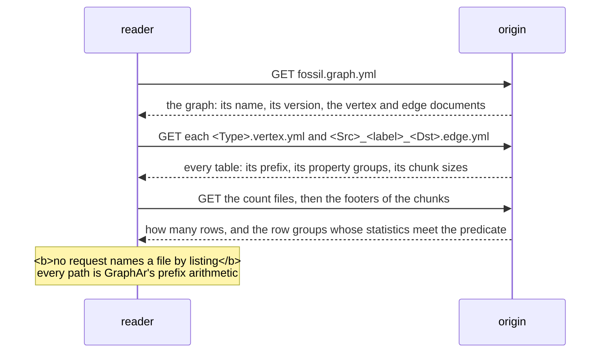

Reading a fossil graph needs a YAML parser and a Parquet reader — no fossil crate, no
`@fossil-lang/*` package, no wasm module, no service. The SQL below is DuckDB because that is the
shortest way to write it down; nothing in it is DuckDB-specific except the syntax.

## The sequence



**A few requests settle where everything is**, and none is a query. A reader over HTTP cannot list a
directory, so nothing is discovered by listing: `fossil.graph.yml` is the one name known in
advance, it names the information files, and GraphAr's rules for paths — which are conventions of
its code and not of its specification — give every count and chunk file from those.

## `attachGraph`

`@kanzo-tech/graphar-duckdb` is that recipe and nothing more: it reads the YAML through the host's
engine, with `read_text`, the count files with `read_blob` and the chunks with `read_parquet`, each
by the name the host gives the path. It links no engine and loads no WASM; nothing reaches the
engine but SQL.

```ts
import * as graphar from '@kanzo-tech/graphar-duckdb';
import { mount } from '@fossil-lang/storage';

// `report` is what `run` answered: { location, dropped }
const m = await mount(engine, host, { job }, 'read', { signal });
await using g = await graphar.attachGraph(
  engine, 'job',
  (paths) => m.files(paths.map((p) => report.location + p)),   // paths relative to fossil.graph.yml
  { entry: 'fossil.graph.yml', signal },
);
// SELECT _graphArVertexIndex, subject, name FROM "job"."Person" WHERE subject = 'https://example.org/user/3'
```

`resolve` is handed paths relative to the graph document and answers, in order, the names the engine
reads them by — a URL, a path, a file registered with the engine, a name a storage mount lent. The
engine is `query(sql, { signal })` in, columns out. `entry` is the graph document. The option `userTypes` gives a user-defined type its DuckDB
spelling — for `langString`, a struct of two `VARCHAR`s named `value` and `lang` — and is needed
only to type a view that has no rows, since a view over chunks reads its type from the Parquet
file.

It makes **a view per table**: `"<catalog>"."<Type>"` for a vertex type, and
`"<catalog>"."<Src>_<label>_<Dst>"` for an edge type, with GraphAr's own columns. A vertex view is
`_graphArVertexIndex`, then every property, the property groups joined on the index. An edge view is
`_graphArSrcIndex`, `_graphArDstIndex`, then every edge property, read from the edge type's first
adjacency list. A graph prefix is read against the document's directory, and the graph a fossil
writer wrote has none.

### The five relations

Beside the views, `attachGraph` states the information files as five relations in GraphAr's words.
These are its answers over `conformance/sample` of `Kanzo-Tech/graphar`, a graph its Parquet writer
wrote in three chunks (a fossil writer's is one), and so a different graph from a fossil one with
the same shape:

`graphar_vertex_types(type, count, ordinal)`: `count` is the type's `vertex_count` file, a
`UBIGINT`; `ordinal` is its place in the graph document's `vertices`, from 1.

```
type        count  ordinal
person      7      1
software    3      2
nickname    3      3
```

`graphar_edge_types(name, src_type, edge_type, dst_type, count, directed, ordinal)`: `name` is the
view's; `count` sums the first adjacency list's `edge_count` files.

```
name                      src_type  edge_type  dst_type  count  directed  ordinal
person_knows_person       person    knows      person    8      true      1
person_created_software   person    created    software  4      true      2
```

`graphar_properties(type, property, data_type, is_primary, is_nullable, ordinal, cardinality)`:
one row per property, `type` the vertex type or the edge type's `name`; `data_type` is GraphAr's word
as written, a user-defined type's name included; `ordinal` is the column's place in the view after
the index columns, from 1; `cardinality` is `single`, `list` or `set`, and a column of any other
than `single` is a DuckDB list.

```
type      property  data_type  is_primary  is_nullable  ordinal  cardinality
person    id        int64      true        false        1        single
person    name      string     false       false        2        single
person    age       int32      false       true         3        single
```

`graphar_extra_info(key, value)`: the graph document's `extra_info`, in order. A fossil graph
carries none, so it is empty. `graphar_chunks(type, kind, path)`: the Parquet file behind each chunk,
by exactly the name `resolve` gave it, with `kind` one of `vertex`, `offset`, `adj_list` and
`edge_property`; it is what a reader of a Parquet footer needs, with no path arithmetic of its own
([statistics](/docs/format/conventions/statistics#reading-them)). Only an edge type's first adjacency
list is listed, with its offset chunks.

`ordinal` is the whole of the global id's stability, and it is `attachGraph`'s convention and
fossil's: [identity](/docs/format/conventions/identity#the-global-id-is-the-readers-arithmetic).

### What it refuses

It refuses, before it makes any view, a graph whose files do not hold together, as a `GraphArError`
with a code: `unreadable` for a file that did not read and `unparseable` for a document that is not
YAML; `invalid` for a document that is not GraphAr's — a key GraphAr does not define, a missing one,
a version other than `gar/v1` — or a count file that is not one `int64`; `unsupported` for a file
type that is not Parquet or a data type with no DuckDB type; and `duplicate` for two relations of
one name. `engine` is the engine refusing a statement that creates a relation. A vertex type whose indices have a gap is `invalid`
([identity](/docs/format/conventions/identity#the-index-is-per-type-and-a-gapless-run)). An abort
rejects with the signal's reason, and what it made is given back.

## The reads

A view per table, and every question after that is SQL:

```sql
-- one vertex by its identity
SELECT * FROM "job"."Person" WHERE subject = 'https://example.org/user/7';

-- the edges out of a range of sources: sorted by source, so the footer prunes
SELECT _graphArSrcIndex, _graphArDstIndex FROM "job"."Person_knows_Person"
 WHERE _graphArSrcIndex BETWEEN 40960 AND 45055;

-- every order with the subject of the person who placed it
SELECT o.subject AS order_iri, p.subject AS person_iri
  FROM "job"."Order_placedBy_Person" AS e
  JOIN "job"."Order"  AS o ON o._graphArVertexIndex = e._graphArSrcIndex
  JOIN "job"."Person" AS p ON p._graphArVertexIndex = e._graphArDstIndex;
```

A predicate on the column a table is ordered by is the one the footers answer well; a predicate on
anything else — a destination, or `subject` — reads every row group. Which edges point *into* a
vertex is that second kind: there is one copy of each relation, ordered by its source
([adjacency](/docs/format/conventions/adjacency)).

Read whole, a relation is small: two million edges' endpoints came back as 16 MB of Arrow in
152–201 ms once cast to `uint32`, in DuckDB-WASM on one thread from a local file.

## With any GraphAr reader

The files are GraphAr's, so GraphAr's own libraries (C++, Java, Spark, PySpark) read a fossil
graph's tables as they read any other — **with one exception**. A graph with a tagged multi-valued
property declares the user-defined type `langString` in its version, and GraphAr's C++ and Java
readers refuse such a graph as a whole: not a skipped column, an unreadable document
([data types](/docs/format/conventions/datatypes#a-tagged-value-and-the-readers-that-refuse-it)).
A graph without one is opened by every reader.

What a GraphAr reader does not have is the global id, the footers' counts as GraphAr states them,
or the mapping: they are fossil's conventions on these pages, and a reader that ignores them has
the tables and not their meaning. The meaning is [`mapping.ttl`](/docs/format/reading/rdf).
